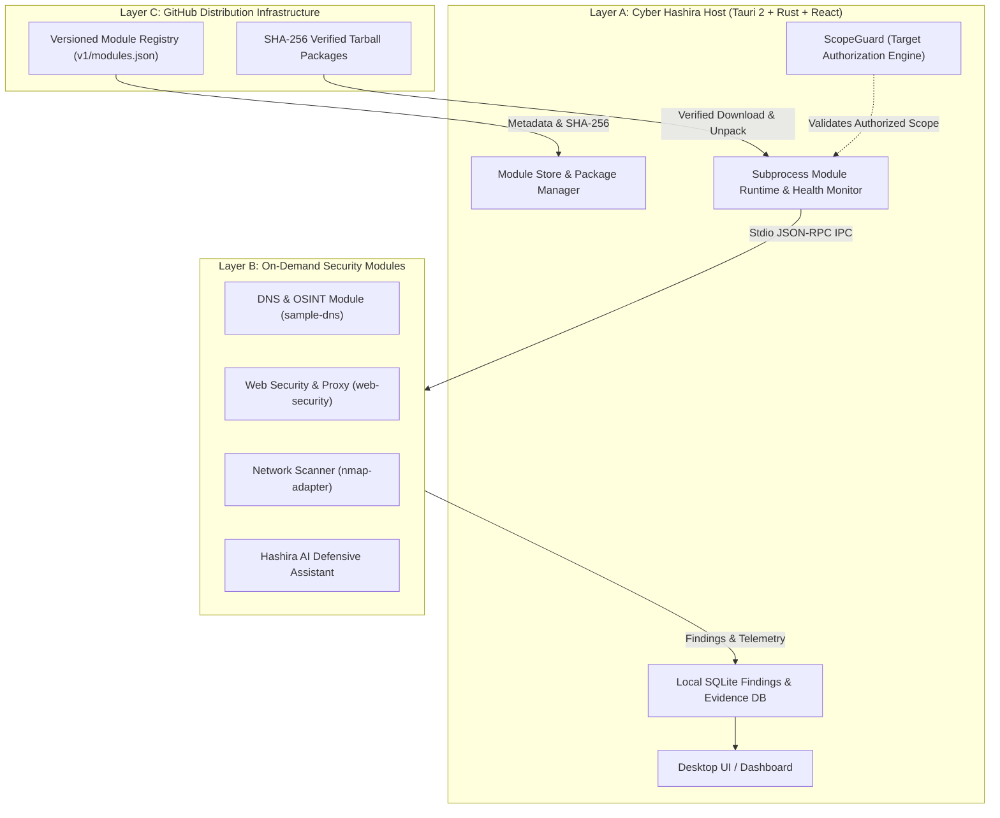

# Cyber Hashira

> **Ultimate Modular Cybersecurity & Penetration Testing Workstation**  
> *GitHub-First • Windows & Ubuntu • Lightweight Host • On-Demand Modules • AI-Powered*

---

## 1. Overview

**Cyber Hashira** is a unified, extensible cybersecurity workstation designed for authorized penetration testing, security auditing, digital forensics, vulnerability management, and defensive analysis.

Unlike legacy security platforms that bundle gigabytes of unrelated scanners into one monolithic installer, Cyber Hashira adheres to a **Strict Modular Architecture**:

- **Lightweight Host Application (Layer A):** Built with Tauri 2, React, TypeScript, Rust, and SQLite. Features workspace management, target authorization boundaries (ScopeGuard), unified findings normalization, evidence tracking, and a built-in Module Store.
- **Independently Installable Modules (Layer B):** Specialized cybersecurity disciplines (DNS Reconnaissance, Web Security, Nmap Network Discovery, Nuclei Vulnerability Assessment, Hashira AI, etc.) packaged and downloaded strictly on-demand.
- **GitHub Distribution Infrastructure (Layer C):** Versioned JSON registry metadata, SHA-256 integrity verification, and releases distributed securely without persistent server dependencies.

---

## 2. Supported Platforms

| Platform | Support Tier | Architecture |
|---|---|---|
| **Windows 10 / 11** | Tier 1 (Official) | x86_64 |
| **Ubuntu 22.04 / 24.04 LTS** | Tier 1 (Official) | x86_64 |
| **macOS (Apple Silicon & Intel)** | Tier 2 (Preview) | aarch64 / x86_64 |
| **Linux (ARM64)** | Planned | aarch64 |

---

## 3. Core Architecture



---

## 4. Key Highlights

### 🛡️ Non-Negotiable Target Authorization (ScopeGuard)
Active security scans and reconnaissance tools are strictly forbidden from launching against unauthorized targets. Every project defines explicit allowlists (Exact Domains, Wildcards `*.example.com`, Single IPs, or CIDR subnets `10.0.0.0/24`). ScopeGuard intercepts and halts any out-of-scope operation before subprocess execution.

### 📦 Safe, Isolated Module Lifecycle
Modules run in isolated child processes with sandboxed privileges and communicate with the Host exclusively via a standardized stdio JSON-RPC contract (`HostRequest` / `ModuleResponse`). No untrusted native dynamic libraries are ever loaded into the privileged Host core process.

### 🔒 Offline-First & Zero Telemetry
Cyber Hashira operates 100% offline. Findings, targets, captured evidence, and audit logs remain on your local disk in a local SQLite database. No scan results or sensitive client data are ever transmitted to third-party telemetry servers.

---

## 5. Quickstart & Development

### Prerequisites
- **Rust:** 1.78+ (`rustc`, `cargo`)
- **Node.js:** v20+ with `pnpm`
- **Python:** 3.10+ (for worker security modules)

### Building the Project
```bash
# Clone the repository
git clone https://github.com/VoidStudioos/Cyber-Hashira.git
cd Cyber-Hashira

# Build and verify the sample module into the registry
python scripts/build_sample_module.py

# Run the automated lifecycle test suite
python tests/test_modular_lifecycle.py

# Install desktop frontend dependencies
pnpm install

# Run the Desktop Host in development mode
pnpm dev
```

---

## 6. Project Structure

```text
Cyber-Hashira/
├── apps/
│   ├── desktop/          # Tauri 2 Desktop Shell + React Frontend
│   └── server/           # Optional multi-user team synchronization server
├── crates/
│   ├── core/             # SQLite DB, project & target manager, findings manager
│   ├── scope-guard/      # Mandatory target authorization & CIDR matching engine
│   ├── module-runtime/   # Secure module installer, unpacker & executor
│   ├── plugin-sdk/       # Standard Plugin Manifest & IPC contract definitions
│   └── proxy/            # Intercepting HTTP/S proxy core
├── modules/
│   └── sample-dns/       # Independent DNS & OSINT module (worker.py + manifest.json)
├── registry/
│   ├── v1/modules.json   # Machine-readable registry catalog
│   └── artifacts/        # SHA-256 verified module tarballs
├── tests/                # Automated verification suites
└── .github/workflows/    # CI/CD pipelines
```

---

## 7. License

Distributed under the **Apache License 2.0**. See [`LICENSE`](LICENSE) for details.
