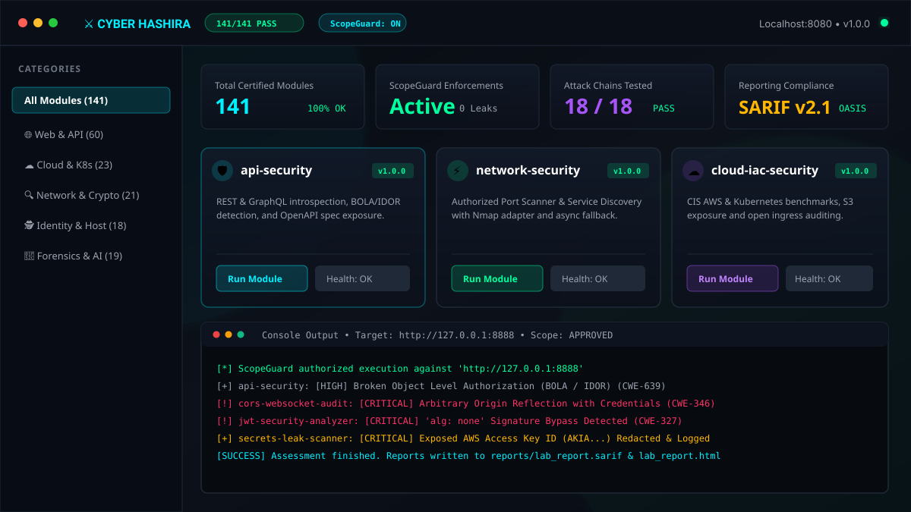
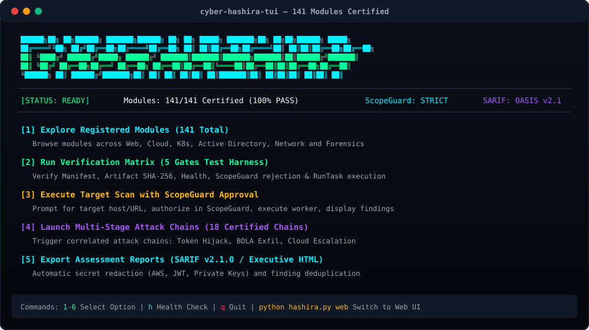
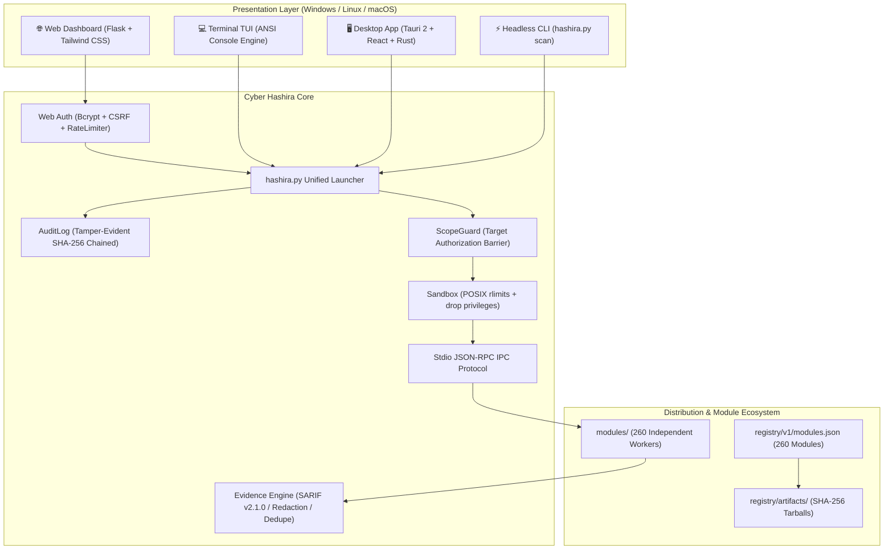

# Cyber Hashira

<p align="center">
  <b><a href="README.fa.md">🇮🇷 نسخه فارسی</a></b> &nbsp;|&nbsp; <b><a href="README.md">🇬🇧 English Version</a></b>
</p>

> **The Ultimate Modular Cybersecurity & Penetration Testing Workstation**  
> *260 Certified Modules • 3 Formats (Web, Terminal TUI, Desktop) • Windows & Linux • Docker-Ready • Offline-First • AI-Assisted*

[](LICENSE)
[](#-certified-modules-catalog-260-modules)
[](tests/test_all_modules_matrix.py)
[](#-user-interfaces-3-formats)
[](#-docker-deployment)
[](scripts/reporting_engine.py)
[](#-supported-platforms)
[](README.fa.md)

<p align="center">
  
</p>
<p align="center">
  
</p>

---

## 📖 Table of Contents
1. [Overview](#-overview)
2. [User Interfaces (3 Formats)](#-user-interfaces-3-formats)
3. [Quick Start & Unified Launcher (`hashira.py`)](#-quick-start--unified-launcher-hashirapy)
4. [Docker Deployment](#-docker-deployment)
5. [Certified Modules Catalog (260 Modules)](#-certified-modules-catalog-260-modules)
6. [Standalone Installers & Distribution](#-standalone-installers--distribution)
7. [Verification & Test Matrix](#-verification--test-matrix)
8. [Architecture & Security Principles](#-architecture--security-principles)
9. [Project Structure](#-project-structure)
10. [License & Ethics](#-license--ethics)

---

## 🌟 Overview

**Cyber Hashira** is a unified, high-performance cybersecurity workstation designed for authorized penetration testing, security posture auditing, digital forensics, red-teaming, and defensive engineering.

Unlike monolithic vulnerability scanners that package gigabytes of fragile dependencies into one rigid installer, Cyber Hashira adheres to a **Strict Modular Architecture**:

- **Presentation Layer (3 Formats):** Run anywhere as a modern **Web Security Dashboard**, an ultra-fast **Terminal TUI**, or a high-performance **Native Desktop Application**.
- **260 Certified Security Modules:** Independently packageable disciplines spanning Web Application Security, Cloud IAM, Kubernetes, Active Directory, AI & LLM Security, IoT & Firmware, ICS/SCADA, Purple Team, Compliance, and Blue Team.
- **Strict ScopeGuard Boundary Enforcement:** Non-negotiable target authorization checks preventing active probes against unauthorized assets.
- **Offline-First & Zero Telemetry:** Operates 100% offline. No telemetry, no cloud leakages, and all evidence stored locally.
- **OASIS SARIF v2.1.0 & Executive Reporting:** Automatic secret redaction, vulnerability deduplication, and export to SARIF (GitHub Code Scanning compatible) and HTML/PDF reports.

---

## 🖥️ User Interfaces (3 Formats)

Cyber Hashira provides three distinct presentation formats engineered for Windows, Linux, and macOS:

| Interface | Technology | Best For | Launch Command |
|---|---|---|---|
| **🌐 Web Dashboard** | Flask + Tailwind CSS + Vanilla JS | Browser-based operations, local networks, remote VPS servers, Docker containers | `python hashira.py web` |
| **💻 Terminal TUI** | Zero-Dependency ANSI Console Engine | Headless servers, SSH sessions, minimal environments, tmux/screen | `python hashira.py tui` |
| **🖥️ Native Desktop App** | Tauri 2 (Rust) + React 18 + Vite + Tailwind | Dedicated desktop workstation with rich visual workspaces | `python hashira.py desktop` |

---

## ⚡ Quick Start & Unified Launcher (`hashira.py`)

The root launcher `hashira.py` provides a single entry point for all workflows:

### 1. Launch the Web Security Dashboard
```bash
python hashira.py web
# With custom host/port:
python hashira.py web --host 0.0.0.0 --port 8080
# Without authentication (dev mode):
python hashira.py web --no-auth
```
Navigate to `http://localhost:8080` (default credentials: `admin` / `hashira-admin`).

### 2. Launch the Terminal TUI
```bash
python hashira.py tui
```

### 3. Launch the Desktop Application
```bash
# On Windows, double-click Launch-Desktop-App.bat or run:
python hashira.py desktop
```

### 4. Run an Authorized Target Scan (CLI)
```bash
python hashira.py scan --target example.com --modules web-security,network-security
```

### 5. Inspect Audit Logs
```bash
python hashira.py audit verify
```

---

## 🐳 Docker Deployment

Deploy Cyber Hashira instantly with zero host dependencies:

```bash
docker-compose up -d
```
Access the web panel at `http://localhost:8080`.

---

## 🛡️ Certified Modules Catalog (260 Modules)

All 260 modules operate independently via the standardized **Stdio JSON-RPC IPC** protocol.

<details>
<summary><b>🌐 1. Web, API & Application Security (80+ Modules) — Click to expand</b></summary>

- `api-security`: REST, GraphQL, and OpenAPI schema security evaluation and rate limiting
- `auth-multi-role`: Multi-tenant authorization & BOLA/BFLA cross-role validator
- `authenticated-crawler`: Authenticated session crawler with form extraction
- `cache-poisoning-deception`: Web cache poisoning & unkeyed header reflection engine
- `client-js-beautifier-analyzer`: Client JavaScript deobfuscator and secret extractor
- `clickjacking-protector`: X-Frame-Options & CSP frame-ancestors validator
- `command-injection-auditor`: OS command injection and metacharacter fuzzer (Commix)
- `content-discovery-fuzzer`: Fast recursive path, directory, and asset discovery fuzzer (ffuf/feroxbuster)
- `content-type-tamper-tester`: Content-Type tamper & parser discrepancy tester (JSON/XML/YAML)
- `cookie-session-hygiene`: HttpOnly, Secure, SameSite, and cookie prefix hygiene inspector
- `cors-misconfiguration-auditor`: Arbitrary origin reflection and null-origin auditor
- `cors-websocket-audit`: WebSocket origin validation and hijacking auditor
- `crlf-injection-engine`: CRLF encoding vectors and HTTP response splitting engine
- `csrf-token-checker`: Forms and API CSRF defense auditor
- `csp-header-linter`: Content Security Policy linter for unsafe-inline / unsafe-eval
- `csp-headers-evaluator`: Comprehensive CSP Level 3 policy evaluator
- `csp-report-collector`: CSP report-uri aggregator and violation analyzer
- `dast-verifier`: DAST evidence verification and safe reproduction engine
- `debug-error-leak-detector`: Verbose framework debug & stack trace leak detector
- `dom-xss-postmessage`: DOM source-to-sink tracking & postMessage security
- `exposed-git-dumper`: Exposed /.git/ repository detector and object dumper (GitTools)
- `fido2-webauthn-implementation-auditor`: WebAuthn / FIDO2 challenge-response verification and origin binding auditor
- `file-upload-vulnerability-scanner`: Unrestricted file upload, polyglots, and MIME bypass scanner
- `forbidden-bypass-auditor`: HTTP 403/401 forbidden access bypass engine (403 Bypasser)
- `graphql-batch-dos`: GraphQL query batching and amplification DoS auditor
- `graphql-depth-limit-auditor`: Deeply nested recursive query DoS tester
- `graphql-engine-fingerprinter`: GraphQL backend engine fingerprinter (Apollo, Hasura, Yoga - graphw00f)
- `graphql-persisted-query-auditor`: GraphQL Automatic Persisted Query (APQ) and cache poisoning auditor
- `graphql-security-audit`: GraphQL introspection and schema exposure analyzer
- `grpc-protobuf-security`: gRPC server reflection and unauthenticated RPC dumper
- `hsts-preload-auditor`: Strict-Transport-Security preload readiness validator
- `http-cache-smuggling-auditor`: HTTP cache smuggling, unkeyed header injection and intermediate CDN desync auditor
- `http-request-smuggling`: CL.TE, TE.CL, and TE.TE HTTP request smuggling engine
- `http-request-smuggling-detector`: Chunked transfer desync discrepancy tester
- `http-security-headers-checker`: Security headers posture (HSTS, CSP, Referrer, Permissions)
- `http-smuggling-detector`: Request smuggling timing & desync analyzer
- `http2-smuggling-hpack-auditor`: HTTP/2 protocol desync and HPACK compression bomb auditor
- `j2ee-deserialization-auditor`: Java J2EE & enterprise middleware deserialization auditor (J2EEScan)
- `js-endpoint-miner`: JavaScript source map analyzer, hidden route & API key miner
- `jwt-confusion-cross-key-auditor`: Public key format confusion (RS256 vs HS256) and multi-tenant JWKS spoofing auditor
- `jwt-expiration-checker`: Token expiration lifetime and missing `exp` claim detector
- `jwt-jku-x5u-injection-auditor`: JSON Web Token (JWT) header jku/x5u public key injection auditor
- `jwt-kid-exposure`: Static or predictable `kid` header traversal analyzer
- `jwt-security-analyzer`: Insecure HMAC/RSA confusion and `alg: none` bypass analyzer
- `jwt-weak-signatures`: Weak HMAC signature and insecure signature detector
- `lfi-path-traversal-engine`: Advanced LFI & PHP filter wrapper traversal engine (LFImap)
- `nosql-injection-auditor`: MongoDB operator injection and authentication bypass tester
- `oauth-account-takeover`: OAuth 2.0 / OIDC pre-ATO and redirect_uri traversal auditor
- `oauth-redirect-uri-validator`: Permissive wildcard and regex redirect_uri auditor
- `oauth-token-replay-detector`: OAuth token reuse and replay vulnerability auditor
- `openapi-spec-linter`: OpenAPI/Swagger security & best-practice linter (Spectral)
- `open-redirect-chainer`: URL parser confusion and OAuth token leak chainer
- `open-redirect-finder`: Open redirect parameter discovery engine
- `param-miner`: Hidden parameter and debug switch discovery engine
- `passkey-credential-binding-auditor`: Passkey synched credentials and device-bound passkey assertion hygiene auditor
- `path-traversal-fuzzer`: Directory traversal and LFI fuzzing engine
- `prototype-pollution-detector`: Client and server prototype pollution detector
- `quic-tls-handshake-auditor`: QUIC transport layer initial packet token and TLS 1.3 handshake cryptographic auditor
- `race-condition-engine`: Single-packet concurrency attack and limit overrun engine
- `rce-parameter-tester`: Remote command execution payload analyzer
- `sourcemap-source-extractor`: JavaScript .js.map source map unbundler and code reconstructor
- `sql-injection-fuzzer`: SQL injection fuzzing and error-pattern analyzer
- `sri-hash-verifier`: Subresource Integrity (SRI) hash presence auditor
- `subresource-integrity-auditor`: External asset hash mismatch and tampering auditor
- `ssrf-gopher-payload-generator`: SSRF gopher:// payload generator for internal services (Gopherus)
- `ssrf-guard-validator`: Cloud metadata (169.254.169.254) and SSRF guard validator
- `ssti-polyglot-engine`: Multi-dialect template injection (Jinja2, Twig, SpEL) engine
- `url-parameter-replacer`: URL query parameter normalizer and replacer for fuzzing (qsreplace/gf)
- `waf-evasion-defense`: WAF Unicode normalization and HPP evasion validator
- `wasm-tamper-memory-protection`: WebAssembly (WASM) module runtime linear memory integrity and bounds enforcement auditor
- `web-technology-fingerprinter`: Wappalyzer & WhatWeb signature technology fingerprinter
- `webhook-url-validator`: Webhook SSRF and private network destination auditor
- `websocket-origin-check`: Cross-Site WebSocket Hijacking origin checker
- `websocket-realtime-fuzzer`: WebSocket real-time binary and fragmented subprotocol fuzzer
- `xml-external-entity-scanner`: XML external entity (XXE) and external DTD scanner
- `xss-polyglot-auditor`: Context-aware Cross-Site Scripting (XSS) reflection auditor (Dalfox/XSStrike)
- `xxe-injection-auditor`: XXE file disclosure and inline entity parsing auditor
</details>

<details>
<summary><b>☁️ 2. Cloud, Sovereign Infrastructure & Mesh (45 Modules) — Click to expand</b></summary>

- `aws-lambda-injection-auditor`: Serverless function (AWS Lambda / Cloud Functions) event data injection auditor
- `aws-lambda-runtime-security`: AWS Lambda runtime persistence, execution context reuse and layer tampering detector
- `aws-pacu-attack-surface-auditor`: AWS penetration testing & privilege escalation auditor (Pacu)
- `aws-secret-leak-scanner`: Source code scanner for exposed AWS access & secret keys
- `aws-security-group-analyzer`: AWS security group & open ingress rule analyzer (CloudMapper)
- `azure-ad-service-principal-auditor`: Azure AD / Entra ID service principal credential hygiene and over-privileged app auditor
- `cilium-ebpf-network-policy-auditor`: Cilium eBPF network policy strict enforcement and default-allow leak auditor
- `cloud-iac-security`: CIS AWS & Terraform security posture auditor
- `cloud-iam`: Cloud IAM excessive privilege and wildcard (`*:*`) policy auditor
- `cloud-iam-policy-drift`: IAM policy drift and unauthorized permission change detector
- `cloud-prowler-compliance`: Multi-cloud CIS benchmark and posture auditor (Prowler)
- `cloudflare-bypass-tester`: Direct origin IP exposure and WAF bypass tester
- `cloudformation-iam-privilege-check`: CloudFormation template IAM privilege escalation analyzer
- `cloudfox-privilege-analyzer`: Cloud privilege & attack path situational awareness auditor (CloudFox)
- `container-image-compliance-dockle`: Container image CIS compliance inspector (Dockle)
- `container-runtime-capabilities`: Docker / Podman dangerous Linux capabilities (`CAP_SYS_ADMIN`)
- `container-security`: CIS Docker Benchmark & insecure Dockerfile auditor
- `docker-runtime`: Unprotected Docker TCP daemon and socket security inspector
- `dockerfile-security-linter`: Dockerfile static security & best-practice linter (Hadolint)
- `gcp-workload-identity-validator`: Google Cloud Workload Identity Federation provider and service account binding validator
- `harbor-container-registry-auditor`: Harbor container registry CVE policy, immutable tags and webhook notification auditor
- `iac-remediation-advisor`: Automated Git diff patch generator for IaC violations
- `iis-configuration-audit`: Microsoft IIS request filtering, security headers and .NET posture
- `istio-service-mesh-authorization`: Istio AuthorizationPolicy and PeerAuthentication strict mTLS boundary validator
- `k8s-admission-controller-auditor`: Kubernetes Validating/Mutating webhook configuration and bypass analyzer
- `k8s-image-scan-integrator`: Kubernetes container image vulnerability integrator
- `k8s-pod-security-policy-check`: Pod Security Standards (PSS) & privileged container auditor
- `k8s-rbac-audit`: Overly permissive ClusterRole and RoleBinding auditor
- `k8s-service-account-token-check`: Default high-privilege ServiceAccount token auditor
- `kics-iac-security-scanner`: Multi-engine Infrastructure as Code security scanner (KICS / Terrascan)
- `kubernetes-cis-bench-auditor`: Kubernetes worker & control plane CIS benchmark auditor (kube-bench)
- `kubernetes-posture`: K8s cluster security posture and hostPath mount inspector
- `kubernetes-yaml-linter`: Kubernetes manifest & Helm chart security linter (KubeLinter / kube-score)
- `multi-cloud-resource-enumerator`: Multi-cloud public asset & storage bucket enumerator (cloud_enum)
- `oci-iam-policy-linter`: Oracle Cloud Infrastructure (OCI) IAM group policy and tenancy compartment access linter
- `openstack-keystone-policy-checker`: OpenStack Keystone multi-tenant policy rules and administrative scope-escalation checker
- `rego-policy-enforcement-checker`: Open Policy Agent (OPA) Rego configuration guard (Conftest)
- `s3-bucket-encryption-check`: S3 server-side encryption (SSE-S3, KMS) enforcement auditor
- `s3-bucket-enumerator`: S3 bucket enumeration and ACL permission auditor
- `s3-public-bucket-detector`: Public read/write S3 bucket exposure detector
- `service-mesh-mtls-auditor`: Kubernetes service mesh (Istio / Linkerd) strict mTLS enforcement auditor
- `terraform-drift-detector`: Terraform state versus cloud reality drift detector and unmanaged asset discovery
</details>

<details>
<summary><b>🔍 3. Network, Discovery & Cryptography (25 Modules) — Click to expand</b></summary>

- `asn-ip-range-mapper`: Autonomous system number (ASN) and corporate BGP prefix mapper
- `cdn-waf-detector`: Cloudflare, Akamai, CloudFront reverse proxy and direct origin IP detector
- `dns-caa-record-auditor`: DNS Certification Authority Authorization (CAA) auditor
- `dns-dnssec-validator`: DNSSEC record existence and signature validation engine
- `dns-rebinding-tester`: Same-Origin Policy DNS rebinding defense auditor (Singularity)
- `dns-wildcard-detector`: Wildcard DNS entry discovery and takeover risk detector
- `dns-zone-transfer-tester`: AXFR DNS zone transfer vulnerability tester
- `http3-quic-downgrade-tester`: HTTP/3 & QUIC 0-RTT replay and protocol downgrade tester
- `live-http-service-prober`: Fast concurrent alive HTTP/HTTPS service prober (httprobe)
- `network-security`: Network discovery, port scanner (Nmap adapter + async socket fallback)
- `pqc-post-quantum-readiness-scanner`: Post-Quantum Cryptography (PQC) readiness & legacy cipher migration auditor
- `reverse-dns-ptr-scanner`: Bulk asynchronous reverse DNS & PTR scanner (hakrevdns)
- `sample-dns`: DNS reconnaissance and misconfiguration analyzer
- `ssh-known-hosts-audit`: SSH known_hosts weak RSA key (<2048-bit) and DSA auditor
- `ssh-weak-ciphers-audit`: Insecure SSH ciphers (`3des`, `blowfish-cbc`) detector
- `subdomain-passive-miner`: Passive subdomain enumeration via Certificate Transparency (crt.sh, Censys)
- `subdomain-takeover-audit`: Dangling DNS CNAME takeover auditor (AWS, GitHub, Azure)
- `tls-certificate-issuer-audit`: Untrusted and self-signed certificate issuer auditor
- `tls-cryptography`: TLS certificate inspector and deprecated protocol auditor
- `tls-misconfiguration-scanner`: SSLv3, TLS 1.0/1.1 deprecation and cipher auditor
- `tls-san-domain-extractor`: TLS certificate Subject Alternative Name (SAN) domain extractor (cero)
- `typosquatting-brand-monitor`: Domain permutation, bitsquatting and typosquatting risk monitor
- `wireless-security`: 802.11 WiFi security inspector (WEP, WPA-TKIP, WPS Pixie-Dust)
- `automotive-uds-analyzer`: Automotive UDS diagnostics (ISO 14229) security analyzer
- `canbus-automotive-security`: CAN Bus vehicle security and arbitration DoS inspector
</details>

<details>
<summary><b>📡 4. IoT, Embedded Firmware, ICS/SCADA & Telecom (13 Modules) — Click to expand</b></summary>

- `5g-telecom-core-security-auditor`: 5G Service Based Architecture (SBA), NRF discovery and HTTP/2 SEPP roaming interface auditor
- `ble-firmware-ota-auditor`: Bluetooth Low Energy (BLE) Over-The-Air (OTA) firmware update tampering and rollback auditor
- `coap-iot-protocol-fuzzer`: Constrained Application Protocol (CoAP) amplification and block-wise transfer fuzzer
- `dnp3-outstation-fuzzer`: Distributed Network Protocol (DNP3) outstation parser crash and command injection fuzzer
- `gnss-gps-spoofing-detector`: GNSS / GPS pseudo-range leap and RF carrier spoofing anomaly detector
- `iot-firmware-extractor`: Firmware unpacking (Binwalk/Sasquatch), squashfs and embedded Linux rootfs extraction
- `jtag-uart-pinout-identifier`: Hardware interface pinout identification, UART baud fuzzer and SWD/JTAG debug analyzer
- `modbus-plc-auditor`: Modbus TCP industrial protocol function code auditor and coil/register unauthorized write detector
- `mqtt-broker-exploit-tester`: Industrial and consumer MQTT message broker anonymous publish and ACL misconfiguration tester
- `opc-ua-security-linter`: OPC Unified Architecture (OPC-UA) endpoint security policy and unencrypted message linter
- `s7comm-siemens-scanner`: Siemens S7comm and S7comm-Plus PLC memory block extraction and CPU state inspector
- `satellite-link-protocol-auditor`: Satellite telecommunication (DVB-S2 / CCSDS) frame header and unencrypted downlink auditor
- `zigbee-zwave-recon`: 802.15.4 Zigbee and Z-Wave pan ID, default network key and trust center analyzer
</details>

<details>
<summary><b>🔎 5. Reconnaissance, OSINT & CMS Security (10 Modules) — Click to expand</b></summary>

- `osint-search-exposure`: Shodan, Censys, FOFA, and search dork exposure analyzer
- `historical-url-miner`: Wayback Machine, AlienVault OTX, and archive URL miner (gau/waybackurls)
- `screenshot-asset-visualizer`: Headless visual snapshot and page title visualizer (GoWitness)
- `wordlist-generator-cewl`: Targeted keyword extraction and custom wordlist builder (CeWL)
- `wordpress-security-auditor`: WordPress CMS, user enumeration, and plugin auditor (WPScan)
- `drupal-joomla-security-auditor`: Drupal and Joomla configuration and CVE inspector (Droopescan/JoomScan)
</details>

<details>
<summary><b>🕵️ 6. Identity, Enterprise Directory & Access Governance (24 Modules) — Click to expand</b></summary>

- `active-directory-shadow-admin-finder`: Active Directory WriteDACL/WriteOwner shadow admin rights and object ACL hijack finder
- `ad-bloodhound-path-analyzer`: Active Directory attack path graph and Domain Admin shortest-path analyzer (BloodHound)
- `adcs-esc-template-auditor`: Active Directory Certificate Services (AD CS) template privilege escalation (ESC1-ESC8)
- `azure-entra-conditional-access-auditor`: Microsoft Entra Conditional Access named location and compliant device bypass auditor
- `credentials-vault`: AES-256-GCM encrypted credential vault and rotation advisor
- `database-audit`: PostgreSQL, MySQL, MongoDB TLS and superuser configuration auditor
- `gpo-security-drift-auditor`: Group Policy Object (GPO) SYSVOL cpassword and permission drift auditor
- `host-posture`: Windows Defender, BitLocker, Firewall, and Linux sysctl posture
- `identity-ad-hygiene`: Active Directory AS-REP / Kerberoasting risk auditor
- `kerberos-silver-ticket-auditor`: Kerberos Service Ticket & SPN weak RC4 encryption hygiene auditor
- `ldap-anonymous-bind-tester`: LDAP anonymous bind and directory enumeration auditor
- `ldap-ssl-tls-enforcement`: LDAP StartTLS / LDAPS transport security auditor
- `ntlm-relay-coercion-scanner`: NTLM authentication coercion (PetitPotam / SpoolSample) and relay scanner
- `okta-idp-hygiene-auditor`: Okta identity provider sign-on policy, application assignment and MFA exemption auditor
- `password-policy-checker`: Active Directory and LDAP password complexity policy auditor
- `password-reuse-detector`: Cross-file, database and repository password reuse detector
- `ping-identity-federation-auditor`: PingFederate WS-Federation and SAML token issuer signature verification auditor
- `saml-metadata-validator`: SAML 2.0 metadata, signature and expiration validator
</details>

<details>
<summary><b>🔬 7. SAST Source Code, Software Supply Chain & Forensics (35 Modules) — Click to expand</b></summary>

- `cicd-supply-chain`: SLSA provenance, Cosign attestation, and supply-chain validator
- `code-injection-evaluator`: Source code analyzer for dangerous functions (`eval`, `exec`, `system`)
- `code-property-graph-analyzer`: Code Property Graph & semantic AST query engine (Joern / AppThreat)
- `cve-dependency-checker`: Dependency CVE vulnerability matcher
- `docker-bake-multistage-linter`: Docker Buildx / Bake multistage cache leakage and builder secret exposure linter
- `dotnet-security-code-analyzer`: .NET & C# source code security analyzer (Security Code Scan)
- `email-security`: SPF, DMARC, DKIM, and BIMI anti-spoofing auditor
- `digital-forensics`: Malware triage, cryptographic hashes, Shannon entropy (>7.0)
- `github-actions-security`: OWASP CI/CD Top 10, unpinned actions and script injection auditor
- `gradle-maven-dependency-integrity`: Maven/Gradle pom.xml and build.gradle artifact signature and SHA-512 integrity verifier
- `hashira-ai`: Bilingual (English/Persian) defensive AI reasoning assistant
- `incident-response`: ISO/IEC 27037 chain-of-custody preservation and timeline correlation
- `java-source-sast-auditor`: Java source & bytecode security bug auditor (Find Security Bugs / SpotBugs)
- `malicious-dependency-behavior-analyzer`: Malicious package & install script behavior analyzer (Socket.dev)
- `mobile-manifest-permissions`: AndroidManifest.xml and Info.plist excessive permission auditor
- `mobile-static-audit`: Mobile APK/IPA static security and cleartext traffic auditor
- `network-forensics-pcap`: Deep packet inspection and cleartext credential harvesting
- `npm-typosquatting-malware-detector`: NPM package registry typosquatting, dependency confusion and postinstall script detector
- `openssf-supply-chain-scorecard`: OpenSSF repository supply chain security scorecard evaluator
- `php-composer-security-auditor`: PHP composer.lock security advisory auditor (Composer audit)
- `php-taint-source-analyzer`: PHP AST taint analysis and source-to-sink tracker (Progpilot)
- `pypi-supply-chain-sentinel`: PyPI wheel binary inspection, uncompiled payload and malicious setup.py analyzer
- `retire-js-vulnerable-libraries`: Outdated and vulnerable client-side library auditor (Retire.js)
- `ruby-bundler-security-auditor`: Ruby Gemfile.lock vulnerability auditor (bundler-audit)
- `rust-cargo-security-auditor`: Rust Cargo.lock security advisory auditor (cargo-audit)
- `sast-source-scanner`: Static Application Security Testing (SAST) source-to-sink engine
- `sbom-dependency-audit`: CycloneDX v1.4 SBOM generation and CVE correlation
- `sbom-generator-syft`: Container & filesystem SBOM generator (Syft)
- `sca-license-compliance`: Viral copyleft (GPL, AGPL) license compliance auditor
- `secrets-leak-scanner`: Multi-cloud secret, token and private key leak scanner
- `slsa-provenance-verifier`: SLSA Level 3/4 build provenance attestation and builder identity cryptographic verifier
- `vulnerability-assessment`: Nuclei template evaluator and CVSS v3.1 scoring
- `yara-offline-scanner`: Safe offline YARA pattern scanner for webshells and beacons
</details>

<details>
<summary><b>🤖 8. AI & Large Language Model (LLM) Adversarial Security (11 Modules) — Click to expand</b></summary>

- `adversarial-patch-detector`: Computer vision adversarial patch and classification perturbation detector
- `ai-agent-sandbox-escape-tester`: Autonomous LLM agent execution tool environment escape and privileged syscall tester
- `huggingface-repo-security-auditor`: HuggingFace model repository pickle scan, safe_tensors compliance and malicious loader auditor
- `llm-excessive-agency-auditor`: Autonomous AI agent excessive privilege and unconfirmed tool execution auditor
- `llm-insecure-output-handling`: LLM unescaped model output downstream XSS/RCE injection auditor
- `llm-prompt-injection-auditor`: Large Language Model direct, indirect prompt injection and jailbreak auditor
- `llm-rag-context-injection-auditor`: RAG document retrieval chunk manipulation and indirect context hijacking auditor
- `llm-system-prompt-extractor`: LLM system prompt extraction, secret leak, and instruction inversion auditor
- `model-inversion-privacy-auditor`: Machine learning model inversion attack and training data memorization leak auditor
- `onnx-model-backdoor-scanner`: ONNX neural network model file backdoor, malicious custom operator and payload scanner
- `rag-vector-poisoning-scanner`: Retrieval-Augmented Generation (RAG) vector store poisoning and context hijacking scanner
</details>

<details>
<summary><b>🎯 9. Purple Team, Detection Engineering & Blue Team (17 Modules) — Click to expand</b></summary>

- `atomic-red-team-coverage-mapper`: Atomic Red Team test mapping against deployed SIEM/EDR detection rules
- `compromised-credential-spill-cleaner`: Corporate credential spill detector and automated token invalidation workflow advisor
- `detection-as-code-rule-validator`: Sigma, ElastAlert, and Splunk detection rule syntax and falsification test validator
- `edr-telemetry-blindspot-detector`: Endpoint Detection & Response (EDR) event drop and unmonitored execution path detector
- `honeypot-telemetry-aggregator`: Decoy honeypot telemetry aggregator, attacker source profiling, and active blocklist generator
- `linux-auditd-syscall-monitor`: Linux Auditd syscall rule evaluation and suspicious privilege escalation execution monitor
- `memory-dump-volatility-triager`: Linux and Windows RAM memory dump acquisition and volatility artifact triager
- `mitre-attack-navigator-generator`: Automatic MITRE ATT&CK Navigator layer generator from aggregated scan findings
- `pcap-dns-tunnel-exfiltration-detector`: Deep packet inspection detector for DNS tunneling, covert channel, and data exfiltration
- `sensor-coverage-attack`: MITRE ATT&CK telemetry coverage against Sysmon, Zeek, Suricata
- `siem-connectors`: Telemetry ingestion from Elastic, Splunk, and Wazuh
- `sigma-threat-hunting`: Sigma YAML detection rule engine with SPL/KQL translation
- `threat-hunting-hypothesis-evaluator`: Detection hypothesis generator and telemetry correlation query validator
- `threat-intelligence`: IOC enrichment and MITRE ATT&CK Enterprise Matrix correlation
- `threat-modeling`: Automated STRIDE / DREAD threat modeling engine
- `windows-event-log-anomaly-detector`: Windows Security EVTX log anomaly detector (Event IDs 4624, 4672, 4688, 4720)
</details>

<details>
<summary><b>📋 10. Compliance & Regulatory Security Posture (5 Modules) — Click to expand</b></summary>

- `hipaa-hitech-security-auditor`: HIPAA Security Rule ePHI encryption, audit controls, and emergency access procedure auditor
- `iso27001-annex-a-posture-auditor`: ISO/IEC 27001:2022 Annex A technical control posture and automated evidence collector
- `nist-sp-800-53-control-assessor`: NIST SP 800-53 Rev 5 federal information systems security control assessor
- `pci-dss-v4-readiness-scanner`: PCI-DSS v4.0 eCommerce payment page, script integrity (6.4.3), and encryption readiness scanner
- `soc2-type2-trust-criteria-evaluator`: SOC 2 Type II Security, Confidentiality, and Availability trust services criteria evaluator
</details>

<details>
<summary><b>⛓️ 11. Web3, Blockchain & Smart Contract Security (4 Modules) — Click to expand</b></summary>

- `erc20-permit-signature-auditor`: ERC-20 / ERC-721 permit EIP-712 cross-chain signature replay auditor
- `evm-smart-contract-auditor`: EVM Solidity smart contract bytecode reentrancy & logic flaw auditor (Slither/Mythril)
- `flash-loan-arbitrage-risk-scanner`: DeFi flash loan price oracle manipulation & AMM spot reserve auditor
- `smart-contract-access-control-guard`: Smart contract uninitialized proxy and unprotected selfdestruct guard
</details>

<details>
<summary><b>💻 12. Client-Side, Desktop & Hybrid Application Security (4 Modules) — Click to expand</b></summary>

- `client-side-storage-crypto-auditor`: Browser LocalStorage, SessionStorage & WebCrypto token leak auditor
- `deep-link-uri-scheme-auditor`: Custom URL protocol scheme and deep link IPC command injection auditor
- `electron-desktop-security-auditor`: Electron desktop app webPreferences nodeIntegration & contextIsolation auditor
- `wasm-security-bytecode-analyzer`: WebAssembly (.wasm) binary memory bounds and bytecode flaw analyzer
</details>

---

## 🧪 Verification & Test Matrix

Cyber Hashira enforces a strict 6-gate certification pipeline across all 260 modules:

```text
===============================================================================================
CYBER HASHIRA - COMPLETE 6-GATE REGISTRY TEST MATRIX (260 MODULES)
===============================================================================================
[*] Discovered 260 module directories. Executing test matrix...

#   | Module ID                    | Manifest | Artifact | Health | Scope  | RunTask | Regression
---------------------------------------------------------------------------------------------------
1   | active-directory-shadow-admin| OK       | OK       | OK     | OK     | OK      | SKIPPED    [PASS]
...
260 | zigbee-zwave-recon           | OK       | OK       | OK     | OK     | OK      | SKIPPED    [PASS]
---------------------------------------------------------------------------------------------------
Matrix Summary: 260/260 modules fully certified across all 6 verification gates.
===============================================================================================
```

### Run Verification Harness:
```bash
python hashira.py matrix
# Or run specific test suites:
python -m pytest tests/test_attack_chain_integration.py tests/test_registry_consistency.py tests/test_bilingual_docs_sync.py
```

---

## 🏛️ Architecture & Security Principles



### Core Tenets:
1. **Mandatory ScopeGuard:** Active scans are blocked unless the target is in the project's authorized target list.
2. **Subprocess Sandboxing:** Modules execute in an isolated environment with sanitized environment variables, restricted POSIX limits, and dropped privileges.
3. **Cryptographic Audit Log:** All operations and task launches are committed to an append-only SHA-256 hash-chained ledger.
4. **Zero Telemetry:** 100% offline-first. No third-party network pings or external tracking.

---

## 📂 Project Structure

```text
Cyber-Hashira/
├── hashira.py                   # Master unified cross-platform launcher
├── Dockerfile                   # Official production container configuration
├── docker-compose.yml           # Multi-service container orchestration
├── .dockerignore                # Optimized Docker ignore patterns
├── ui/
│   ├── web/                     # Web Security Dashboard (Flask + HTML/Tailwind)
│   └── tui/                     # Interactive Terminal Console Dashboard
├── apps/
│   └── desktop/                 # Tauri 2 Desktop Shell (Rust + React + Vite)
├── engine/                      # Security core (sandbox, audit log, scopeguard)
├── modules/                     # 260 Certified Cybersecurity Modules
├── registry/
│   ├── v1/modules.json          # Catalog metadata for 260 certified modules
│   ├── artifacts/               # SHA-256 verified module archive packages (.tar.gz)
│   └── MIGRATIONS.md            # Module migration and deprecation policy
├── docs/
│   ├── MODULE_DEVELOPER_GUIDE.md# Certified module developer handbook
│   └── SANDBOXING.md            # IPC isolation and security architecture
├── scripts/
│   ├── build_installers.py      # Standalone installer packager (Windows & Linux)
│   ├── build_windows.bat        # Windows one-click packager
│   ├── build_linux.sh           # Linux one-click packager
│   ├── package_all_modules.py   # Synchronizes tarballs and registry metadata
│   ├── cyber_hashira_cli.py     # Headless CI/CD runner
│   └── reporting_engine.py      # SARIF v2.1.0, redaction, and deduplication engine
├── tests/
│   ├── test_all_modules_matrix.py # 6-gate test harness for all 260 modules
│   ├── test_registry_consistency.py # 1:1 registry and artifact integrity test
│   ├── test_bilingual_docs_sync.py # English/Persian documentation sync test
│   ├── test_attack_chain_integration.py # Multi-stage attack chain integration test
│   └── test_bug_bounty_suite.py # Bug bounty engines regression test suite
└── dist/
    └── packages/                # Generated standalone distribution installers
```

---

## ⚖️ License & Ethics

Distributed under the **Apache License 2.0**. See [`LICENSE`](LICENSE) for details.

> **Ethical & Legal Notice:** Cyber Hashira is engineered exclusively for authorized security assessments, academic research, and certified penetration testing with explicit written consent. Unauthorized scanning, testing, or attacking of networks, systems, or assets without prior permission is strictly illegal.
