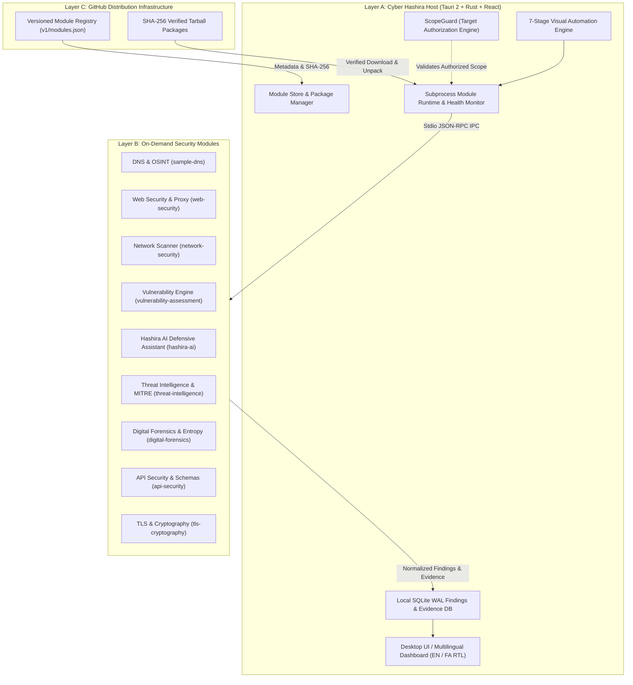

# Cyber Hashira

> **Ultimate Modular Cybersecurity & Penetration Testing Workstation**  
> *GitHub-First • Windows & Ubuntu • Lightweight Host • On-Demand Modules • AI-Powered*

[](LICENSE)
[](.github/workflows/ci.yml)
[](tests/)
[](#2-supported-platforms)

---

## 1. Overview

**Cyber Hashira** is a unified, extensible cybersecurity workstation designed for authorized penetration testing, security auditing, digital forensics, vulnerability management, and defensive analysis.

Unlike legacy security platforms that bundle gigabytes of unrelated scanners into one monolithic installer, Cyber Hashira adheres to a **Strict Modular Architecture**:

- **Lightweight Host Application (Layer A):** Built with Tauri 2, React, TypeScript, Rust, and SQLite WAL. Features workspace management, target authorization boundaries (ScopeGuard), unified findings normalization, evidence tracking, workflow automation, and a built-in Module Store.
- **Independently Installable Modules (Layer B):** Specialized cybersecurity disciplines packaged and downloaded strictly on-demand.
- **GitHub Distribution Infrastructure (Layer C):** Versioned JSON registry metadata, SHA-256 integrity verification, and releases distributed securely without persistent server dependencies.

---

## 2. Supported Platforms

| Platform | Support Tier | Architecture | Package Formats |
|---|---|---|---|
| **Windows 10 / 11** | Tier 1 (Official) | x86_64 | MSI Installer, Standalone EXE |
| **Ubuntu 22.04 / 24.04 LTS** | Tier 1 (Official) | x86_64 | DEB Package, AppImage |
| **macOS (Apple Silicon & Intel)** | Tier 2 (Preview) | aarch64 / x86_64 | DMG Package |
| **Linux (ARM64)** | Planned | aarch64 | Tarball |

---

## 3. Core Architecture



---

## 4. Key Highlights

### 🛡️ Non-Negotiable Target Authorization (ScopeGuard)
Active security scans and reconnaissance tools are strictly forbidden from launching against unauthorized targets. Every project defines explicit allowlists (Exact Domains, Wildcards `*.example.com`, Single IPs, or CIDR subnets `192.168.1.0/24`). ScopeGuard intercepts and halts any out-of-scope operation before subprocess execution.

### 📦 Safe, Isolated Module Lifecycle
Modules run in isolated child processes with sandboxed privileges and communicate with the Host exclusively via a standardized stdio JSON-RPC contract (`HostRequest` / `ModuleResponse`). No untrusted native dynamic libraries are ever loaded into the privileged Host core process.

### 🤖 Hashira AI Defensive Assistant & Sanitizer
Built-in defensive intelligence supporting English and Persian (فارسی). Automatically redacts API keys, credentials, and tokens before prompting, generates CVSS v3.1 score explanations, and crafts automated remediation code patches.

### 🌐 Bilingual Support with Full RTL/LTR Switching
Seamless real-time switching between English (Left-to-Right) and Persian (Right-to-Left) with tailored typography, directional layouts, and localized report generation.

### 🎨 Admin Visual Customizer & Dynamic Categories
Administrators have full control over the presentation of security modules in the Module Store. Directly edit display titles, reassign modules to custom categories (or create new categories on the fly), upload/specify custom banner images (Unsplash, CDN or local), and switch module icons with persistent local storage.

### 🔒 Offline-First & Zero Telemetry
Cyber Hashira operates 100% offline. Findings, targets, captured evidence, and audit logs remain on your local disk in a local SQLite database. No scan results or sensitive client data are ever transmitted to third-party telemetry servers.

---

## 5. Security Disciplines & Available Modules

The official Cyber Hashira catalog currently distributes **30 independently packaged, verified modules**:

| Module ID | Name | Version | Category | Capabilities |
|---|---|:---:|---|---|
| `sample-dns` | DNS Reconnaissance | 1.0.0 | Reconnaissance | A, AAAA, MX, NS, TXT record lookups & DNS verification |
| `web-security` | Web Security Workspace | 1.0.0 | Web Security | Intercepting proxy, HTTP history, Repeater, Decoder/Encoder, JWT analyzer, passive scan |
| `network-security` | Network Discovery & Port Scanner | 1.0.0 | Network Security | Nmap adapter + async socket fallback, banner grabbing, service identification |
| `vulnerability-assessment` | Vulnerability Assessment Engine | 1.0.0 | Vulnerability | Nuclei template parser, CVE/CWE mapping, CVSS v3.1 scoring, SARIF v2.1.0 export |
| `hashira-ai` | Hashira AI Defensive Assistant | 1.0.0 | AI Assistant | Secret redaction, CVSS triage, bilingual Persian/English reasoning, remediation patches |
| `threat-intelligence` | Threat Intelligence & MITRE Engine | 1.0.0 | Threat Intel | IOC enrichment (IP, domain, hashes), LockBit/Cobalt Strike triage, MITRE ATT&CK v14 mapping |
| `digital-forensics` | Digital Forensics & Malware Triage | 1.0.0 | Digital Forensics | MD5/SHA-1/SHA-256 hashes, Shannon entropy (>7.0 packed binary detection), chain-of-custody |
| `api-security` | API Security & Schema Assessment | 1.0.0 | API Security | REST/GraphQL introspection, Swagger/OpenAPI exposure discovery, BOLA/IDOR checks |
| `tls-cryptography` | TLS & Cryptography Inspector | 1.0.0 | Cryptography | X.509 certificate profiles, weak cipher suites (RC4, 3DES, CBC), protocol deprecation checks |
| `github-actions-security` | GitHub Actions & CI/CD Security | 1.0.0 | Source Code & CI/CD | OWASP CI/CD Top 10, Wiz Code best practices, command injection in `run:`, unpinned actions, overprivileged tokens |
| `container-security` | Container & Dockerfile Security | 1.0.0 | Container Security | CIS Docker Benchmark, root user execution, sensitive socket mounts (/var/run/docker.sock), exposed port auditing |
| `wireless-security` | Wireless & 802.11 WiFi Security | 1.0.0 | Wireless Security | WEP deprecation, WPA-TKIP auditing, WPS Pixie-Dust risk analysis, open network detection |
| `canbus-automotive-security` | CAN Bus & Automotive Vehicle Security | 1.0.0 | Automotive & Hardware | CAN 2.0A/B arbitration DoS flooding (ID 0x000), UDS SecurityAccess service 0x27 bypass analysis |
| `network-forensics-pcap` | Network Forensics & PCAP Credentials | 1.0.0 | Network Forensics | Deep packet inspection, cleartext password harvesting, NetNTLMv2 hash recovery |
| `sensor-coverage-attack` | MITRE Sensor Mappings & Detection Coverage | 1.0.0 | Detection & Threat Intel | MITRE CTID SMAP, Sysmon, Auditd, Zeek, Suricata telemetry coverage & detection blind spots |
| `email-security` | Email Security & Anti-Spoofing Auditor | 1.0.0 | Email & Phishing Defense | SPF (+all/~all/-all), DMARC (p=reject vs none), DKIM alignment, BIMI, MTA-STS, raw EML forensics |
| `sbom-dependency-audit` | Software Bill of Materials & Dependency Auditor | 1.0.0 | Supply Chain Security | CycloneDX v1.4 SBOM generation, package.json / requirements.txt / go.mod CVE matching & copyleft audit |
| `secrets-leak-scanner` | Secrets, API Keys & PII Leak Scanner | 1.0.0 | DevSecOps & Secrets | Multi-cloud credential leak detection (AWS, GitHub, Stripe, OpenAI, SSH keys) & Shannon entropy |
| `cloud-iac-security` | Infrastructure as Code & Cloud Security Posture | 1.0.0 | Cloud & IaC Security | CIS AWS & K8s benchmarks, public S3 buckets, open 0.0.0.0/0 SSH/RDP, privileged pods |
| `sigma-threat-hunting` | Sigma & YARA Threat Hunting Rule Engine | 1.0.0 | Threat Detection & Hunting | Sigma YAML detection evaluation, Splunk SPL & Elasticsearch KQL query translation |
| `identity-ad-hygiene` | Active Directory & Identity Hygiene Auditor | 1.0.0 | Identity & Access Management | CIS AD benchmarks, AS-REP Roasting pre-auth risks, Kerberoasting SPN audit, stale admin accounts, SMBv1/NTLMv1 |
| `csp-headers-evaluator` | Content Security Policy & Header Auditor | 1.0.0 | Web Security | CSP Level 3 directives, script-src unsafe-inline/eval, clickjacking frame-ancestors, HSTS preload |
| `cors-websocket-audit` | CORS & WebSocket Security Auditor | 1.0.0 | Web Security | Arbitrary reflected origin with credentials, null origin trust, CSWSH WebSocket hijacking audit |
| `cookie-session-hygiene` | Cookie Security & Session Hygiene Inspector | 1.0.0 | Web Security | HttpOnly, Secure, SameSite, __Host- / __Secure- prefixes, CSPRNG session token entropy |
| `subdomain-takeover-audit` | Subdomain Takeover & Dangling DNS Auditor | 1.0.0 | Web Security | Dangling CNAMEs pointing to unclaimed AWS S3, GitHub Pages, Heroku, Azure, Fastly, Shopify |
| `ssrf-guard-validator` | SSRF & Cloud Metadata Defense Validator | 1.0.0 | Web Security | Cloud metadata 169.254.169.254, RFC 1918 private subnets, decimal/octal IP obfuscation, dangerous schemes |
| `graphql-security-audit` | GraphQL Schema & Query Depth Auditor | 1.0.0 | API Security | Introspection queries, circular query depth DoS, batching amplification, field suggestion leaks |
| `jwt-security-analyzer` | JWT & Cryptographic Token Analyzer | 1.0.0 | Web Security | 'alg: none' bypass, weak HMAC secrets, RSA-to-HMAC confusion, missing 'exp', 'kid' path traversal |
| `waf-evasion-defense` | WAF & Normalization Defense Validator | 1.0.0 | Web Security | Full-width Unicode normalization discrepancies, HPP precedence mismatches, matrix path desync |
| `sast-source-scanner` | Static Application Security Testing (SAST) | 1.0.0 | Source Code & CI/CD | Source-to-sink detection for SQL injection, command injection (shell=True), eval/exec, insecure deserialization |

---

## 6. Quickstart & Development

### Prerequisites
- **Node.js:** v20+ with `pnpm`
- **Python:** 3.10+ (for module workers and test suites)
- **Rust:** 1.78+ (`rustc`, `cargo` for building native Host components)

### Setup & Automated Verification
```bash
# 1. Clone the repository
git clone https://github.com/VoidStudioos/Cyber-Hashira.git
cd Cyber-Hashira

# 2. Package all security modules and update registry catalog
python scripts/build_modules.py

# 3. Run the complete automated test suite (39 tests)
python tests/test_modular_lifecycle.py
python tests/test_web_security_module.py
python tests/test_network_security_module.py
python tests/test_vulnerability_module.py
python tests/test_hashira_ai_module.py
python tests/test_threat_intel_module.py
python tests/test_forensics_module.py
python tests/test_api_security_module.py
python tests/test_tls_cryptography_module.py

# 4. Install desktop frontend dependencies and build
pnpm install
pnpm --filter @cyber-hashira/desktop build

# 5. Run the Desktop Host in development mode
pnpm dev
```

---

## 7. Project Structure

```text
Cyber-Hashira/
├── apps/
│   ├── desktop/          # Tauri 2 Desktop Shell + React 18 + Vite + Tailwind CSS
│   └── server/           # Optional multi-user team synchronization server
├── crates/
│   ├── core/             # SQLite DB WAL, project & target manager, findings manager
│   ├── scope-guard/      # Mandatory target authorization & CIDR matching engine
│   ├── module-runtime/   # Secure module installer, unpacker & JSON-RPC executor
│   ├── plugin-sdk/       # Standard Plugin Manifest & IPC contract definitions
│   └── proxy/            # Intercepting HTTP/S proxy core
├── modules/              # Independently maintainable security modules
│   ├── api-security/
│   ├── forensics/
│   ├── hashira-ai/
│   ├── network-security/
│   ├── sample-dns/
│   ├── threat-intelligence/
│   ├── tls-cryptography/
│   ├── vulnerability/
│   └── web-security/
├── registry/
│   ├── v1/modules.json   # Machine-readable registry catalog
│   └── artifacts/        # SHA-256 verified module tarball archives
├── scripts/              # Module build and catalog packaging automation
├── tests/                # 9 comprehensive Python automated verification suites
└── .github/workflows/    # Multi-platform CI/CD pipelines (Windows, Ubuntu, Linting)
```

---

## 8. License & Ethics

Distributed under the **Apache License 2.0**. See [`LICENSE`](LICENSE) for details.

> **Ethical Use Notice:** Cyber Hashira is engineered exclusively for authorized security research, educational purposes, and certified penetration testing with explicit written consent. Unauthorized scanning of third-party networks or systems is strictly illegal and prohibited.
