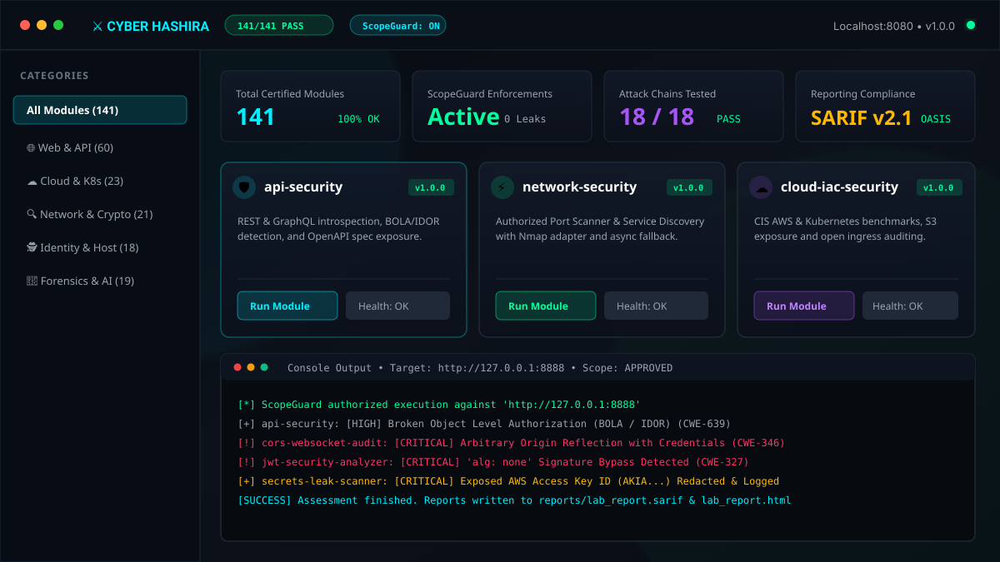
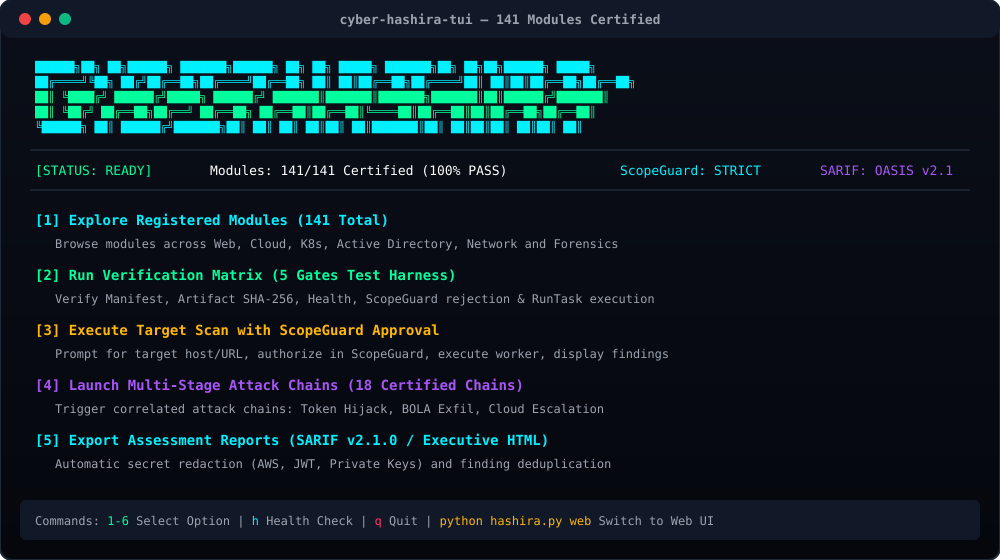
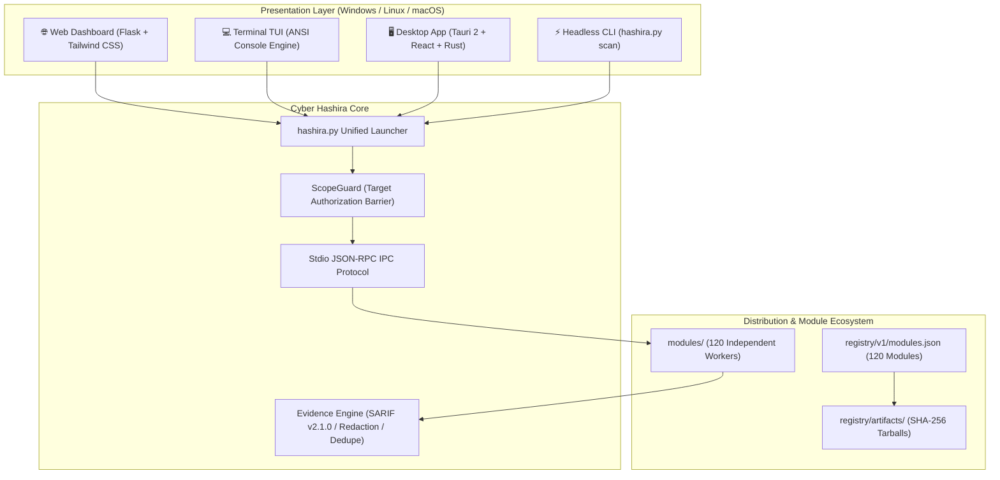

# Cyber Hashira

> **The Ultimate Modular Cybersecurity & Penetration Testing Workstation**  
> *174 Certified Modules • 3 Formats (Web, Terminal TUI, Desktop) • Windows & Linux • Docker-Ready • Offline-First • AI-Assisted*

[](LICENSE)
[](tests/test_all_modules_matrix.py)
[](#-user-interfaces-3-formats)
[](#-docker-deployment)
[](scripts/reporting_engine.py)
[](#-supported-platforms)
[](README.fa.md)

<p align="center">
  
</p>
<p align="center">
  
</p>

---

## 📖 Table of Contents
1. [Overview](#-overview)
2. [User Interfaces (3 Formats)](#-user-interfaces-3-formats)
3. [Quick Start & Unified Launcher (`hashira.py`)](#-quick-start--unified-launcher-hashirapy)
4. [Docker Deployment](#-docker-deployment)
5. [Certified Modules Catalog (174 Modules)](#-certified-modules-catalog-174-modules)
6. [Standalone Installers & Distribution](#-standalone-installers--distribution)
7. [Verification & Test Matrix](#-verification--test-matrix)
8. [Architecture & Security Principles](#-architecture--security-principles)
9. [Project Structure](#-project-structure)
10. [License & Ethics](#-license--ethics)

---

## 🌟 Overview

**Cyber Hashira** is a unified, high-performance cybersecurity workstation designed for authorized penetration testing, security posture auditing, digital forensics, red-teaming, and defensive engineering.

Unlike monolithic vulnerability scanners that package gigabytes of fragile dependencies into one rigid installer, Cyber Hashira adheres to a **Strict Modular Architecture**:

- **Presentation Layer (3 Formats):** Run anywhere as a modern **Web Security Dashboard**, an ultra-fast **Terminal TUI**, or a high-performance **Native Desktop Application**.
- **174 Certified Security Modules:** Independently packageable disciplines spanning Web Application Security, Cloud IAM, Kubernetes, Active Directory, Reverse Engineering, Cryptography, and Supply-Chain.
- **Strict ScopeGuard Boundary Enforcement:** Non-negotiable target authorization checks preventing active probes against unauthorized assets.
- **Offline-First & Zero Telemetry:** Operates 100% offline. No telemetry, no cloud leakages, and all evidence stored locally.
- **OASIS SARIF v2.1.0 & Executive Reporting:** Automatic secret redaction, vulnerability deduplication, and export to SARIF (GitHub Code Scanning compatible) and HTML/PDF reports.

---

## 🖥️ User Interfaces (3 Formats)

Cyber Hashira provides three distinct presentation formats engineered for Windows, Linux, and macOS:

| Interface | Technology | Best For | Launch Command |
|---|---|---|---|
| **🌐 Web Dashboard** | Flask + Tailwind CSS + Vanilla JS | Browser-based operations, local networks, remote VPS servers, Docker containers | `python hashira.py web` |
| **💻 Terminal TUI** | Zero-Dependency ANSI Console Engine | Headless servers, SSH sessions, minimal environments, tmux/screen | `python hashira.py tui` |
| **🖥️ Native Desktop App** | Tauri 2 (Rust) + React 18 + Vite + Tailwind | Dedicated desktop workstation with rich visual workspaces | `python hashira.py desktop` |

---

## ⚡ Quick Start & Unified Launcher (`hashira.py`)

The root launcher `hashira.py` provides a single entry point for all workflows:

### 1. Launch the Web Security Dashboard
```bash
python hashira.py web
# With custom host/port:
python hashira.py web --host 0.0.0.0 --port 8080
```
Open [http://localhost:8080](http://localhost:8080) to access the interactive dashboard.

### 2. Launch the Interactive Terminal TUI
```bash
python hashira.py tui
```
Navigate modules, run instant health checks, and execute scans directly in your terminal.

### 3. Launch the Native Desktop App
```bash
python hashira.py desktop
```

### 4. Execute a Headless Scan (CLI / CI/CD)
```bash
# Direct scan against authorized target:
python hashira.py scan --module api-security --target https://api.example.com --simulate

# Run port & network discovery:
python hashira.py scan --module network-security --target 192.168.1.10
```

### 5. List Certified Modules
```bash
# List all 174 certified modules:
python hashira.py list

# Filter by category:
python hashira.py list --category "Cloud"
python hashira.py list --category "Web"
```

### 6. Run the Full 174-Module Verification Matrix
```bash
python hashira.py matrix
```

---

## 🐳 Docker Deployment

Run Cyber Hashira in an isolated, portable container without installing local dependencies:

### Using Docker Compose (Recommended)
```bash
# 1. Clone the repository
git clone https://github.com/VoidStudioos/Cyber-Hashira.git
cd Cyber-Hashira

# 2. Start the Web Dashboard in the background
docker-compose up -d

# 3. View logs
docker-compose logs -f
```
Access the dashboard at `http://localhost:8080`. Evidence and reports are automatically mounted to `./evidence` and `./reports`.

### Run Interactive Terminal TUI in Docker
```bash
docker-compose run --rm tui
```

### Build & Run Manually
```bash
docker build -t cyber-hashira .
docker run -d -p 8080:8080 --name cyber-hashira-app cyber-hashira
```

---

## 📦 Standalone Installers & Distribution

Generate portable, standalone bundles for Windows and Linux in seconds:

```bash
# Generate both Windows (.zip) and Linux (.tar.gz) standalone distributions:
python scripts/build_installers.py
```

### Output Packages:
- **Windows Portable Standalone:** `dist/packages/cyber-hashira-windows-x64-v1.0.0.zip`
  - Includes one-click `Launch-Web-Panel.bat`, `Launch-Terminal-TUI.bat`, and `Verify-All-Modules.bat`.
- **Linux Portable Standalone:** `dist/packages/cyber-hashira-linux-x64-v1.0.0.tar.gz`
  - Includes `launch-web.sh`, `launch-tui.sh`, and `cyber-hashira.desktop` application menu entry.

---

## 🛡️ Certified Modules Catalog (174 Modules)

Cyber Hashira includes **174 independently certified security modules**, categorized across specialized cybersecurity domains:

<details>
<summary><b>🌐 1. Web Application & API Security (70+ Modules) — Click to expand</b></summary>

- `web-security`: Intercepting proxy, history, repeater, decoder, passive analysis
- `api-security`: REST & GraphQL introspection, OpenAPI spec exposure, BOLA detection
- `api-contract-drift-auditor`: Live HTTP API vs OpenAPI specification drift auditor (Dredd)
- `api-fuzzing`: Schema-aware API fuzzer & boundary tester
- `api-gateway-rate-limit-audit`: Rate-limit and throttling rule auditor for API Gateways
- `api-schema-fuzzing`: Dynamic parameter and type-confusion generator from schemas
- `auth-multi-role`: Multi-tenant authorization & BOLA/BFLA cross-role validator
- `authenticated-crawler`: Authenticated session crawler with form extraction
- `cache-poisoning-deception`: Web cache poisoning & unkeyed header reflection engine
- `client-js-beautifier-analyzer`: Client JavaScript deobfuscator and secret extractor
- `clickjacking-protector`: X-Frame-Options & CSP frame-ancestors validator
- `command-injection-auditor`: OS command injection and metacharacter fuzzer (Commix)
- `content-discovery-fuzzer`: Fast recursive path, directory, and asset discovery fuzzer (ffuf/feroxbuster)
- `content-type-tamper-tester`: Content-Type tamper & parser discrepancy tester (JSON/XML/YAML)
- `cookie-session-hygiene`: HttpOnly, Secure, SameSite, and cookie prefix hygiene inspector
- `cors-misconfiguration-auditor`: Arbitrary origin reflection and null-origin auditor
- `cors-websocket-audit`: WebSocket origin validation and hijacking auditor
- `crlf-injection-engine`: CRLF encoding vectors and HTTP response splitting engine
- `csrf-token-checker`: Forms and API CSRF defense auditor
- `csp-header-linter`: Content Security Policy linter for unsafe-inline / unsafe-eval
- `csp-headers-evaluator`: Comprehensive CSP Level 3 policy evaluator
- `csp-report-collector`: CSP report-uri aggregator and violation analyzer
- `dast-verifier`: DAST evidence verification and safe reproduction engine
- `debug-error-leak-detector`: Verbose framework debug & stack trace leak detector
- `dom-xss-postmessage`: DOM source-to-sink tracking & postMessage security
- `exposed-git-dumper`: Exposed /.git/ repository detector and object dumper (GitTools)
- `file-upload-vulnerability-scanner`: Unrestricted file upload, polyglots, and MIME bypass scanner
- `forbidden-bypass-auditor`: HTTP 403/401 forbidden access bypass engine (403 Bypasser)
- `graphql-batch-dos`: GraphQL query batching and amplification DoS auditor
- `graphql-depth-limit-auditor`: Deeply nested recursive query DoS tester
- `graphql-engine-fingerprinter`: GraphQL backend engine fingerprinter (Apollo, Hasura, Yoga - graphw00f)
- `graphql-security-audit`: GraphQL introspection and schema exposure analyzer
- `grpc-protobuf-security`: gRPC server reflection and unauthenticated RPC dumper
- `hsts-preload-auditor`: Strict-Transport-Security preload readiness validator
- `http-request-smuggling`: CL.TE, TE.CL, and TE.TE HTTP request smuggling engine
- `http-request-smuggling-detector`: Chunked transfer desync discrepancy tester
- `http-security-headers-checker`: Security headers posture (HSTS, CSP, Referrer, Permissions)
- `http-smuggling-detector`: Request smuggling timing & desync analyzer
- `j2ee-deserialization-auditor`: Java J2EE & enterprise middleware deserialization auditor (J2EEScan)
- `js-endpoint-miner`: JavaScript source map analyzer, hidden route & API key miner
- `jwt-expiration-checker`: Token expiration lifetime and missing `exp` claim detector
- `jwt-kid-exposure`: Static or predictable `kid` header traversal analyzer
- `jwt-security-analyzer`: Insecure HMAC/RSA confusion and `alg: none` bypass analyzer
- `jwt-weak-signatures`: Weak HMAC signature and insecure signature detector
- `lfi-path-traversal-engine`: Advanced LFI & PHP filter wrapper traversal engine (LFImap)
- `nosql-injection-auditor`: MongoDB operator injection and authentication bypass tester
- `oauth-account-takeover`: OAuth 2.0 / OIDC pre-ATO and redirect_uri traversal auditor
- `oauth-redirect-uri-validator`: Permissive wildcard and regex redirect_uri auditor
- `oauth-token-replay-detector`: OAuth token reuse and replay vulnerability auditor
- `openapi-spec-linter`: OpenAPI/Swagger security & best-practice linter (Spectral)
- `open-redirect-chainer`: URL parser confusion and OAuth token leak chainer
- `open-redirect-finder`: Open redirect parameter discovery engine
- `param-miner`: Hidden parameter and debug switch discovery engine
- `path-traversal-fuzzer`: Directory traversal and LFI fuzzing engine
- `prototype-pollution-detector`: Client and server prototype pollution detector
- `race-condition-engine`: Single-packet concurrency attack and limit overrun engine
- `rce-parameter-tester`: Remote command execution payload analyzer
- `sourcemap-source-extractor`: JavaScript .js.map source map unbundler and code reconstructor
- `sql-injection-fuzzer`: SQL injection fuzzing and error-pattern analyzer
- `sri-hash-verifier`: Subresource Integrity (SRI) hash presence auditor
- `subresource-integrity-auditor`: External asset hash mismatch and tampering auditor
- `ssrf-gopher-payload-generator`: SSRF gopher:// payload generator for internal services (Gopherus)
- `ssrf-guard-validator`: Cloud metadata (169.254.169.254) and SSRF guard validator
- `ssti-polyglot-engine`: Multi-dialect template injection (Jinja2, Twig, SpEL) engine
- `url-parameter-replacer`: URL query parameter normalizer and replacer for fuzzing (qsreplace/gf)
- `waf-evasion-defense`: WAF Unicode normalization and HPP evasion validator
- `web-technology-fingerprinter`: Wappalyzer & WhatWeb signature technology fingerprinter
- `webhook-url-validator`: Webhook SSRF and private network destination auditor
- `websocket-origin-check`: Cross-Site WebSocket Hijacking origin checker
- `xml-external-entity-scanner`: XML external entity (XXE) and external DTD scanner
- `xss-polyglot-auditor`: Context-aware Cross-Site Scripting (XSS) reflection auditor (Dalfox/XSStrike)
- `xxe-injection-auditor`: XXE file disclosure and inline entity parsing auditor
</details>

<details>
<summary><b>☁️ 2. Cloud, Infrastructure, Kubernetes & Containers (35+ Modules) — Click to expand</b></summary>

- `aws-pacu-attack-surface-auditor`: AWS penetration testing & privilege escalation auditor (Pacu)
- `aws-secret-leak-scanner`: Source code scanner for exposed AWS access & secret keys
- `aws-security-group-analyzer`: AWS security group & open ingress rule analyzer (CloudMapper)
- `cloud-iac-security`: CIS AWS & Terraform security posture auditor
- `cloud-iam`: Cloud IAM excessive privilege and wildcard (`*:*`) policy auditor
- `cloud-iam-policy-drift`: IAM policy drift and unauthorized permission change detector
- `cloud-prowler-compliance`: Multi-cloud CIS benchmark and posture auditor (Prowler)
- `cloudflare-bypass-tester`: Direct origin IP exposure and WAF bypass tester
- `cloudformation-iam-privilege-check`: CloudFormation template IAM privilege escalation analyzer
- `cloudfox-privilege-analyzer`: Cloud privilege & attack path situational awareness auditor (CloudFox)
- `container-image-compliance-dockle`: Container image CIS compliance inspector (Dockle)
- `container-runtime-capabilities`: Docker / Podman dangerous Linux capabilities (`CAP_SYS_ADMIN`)
- `container-security`: CIS Docker Benchmark & insecure Dockerfile auditor
- `docker-runtime`: Unprotected Docker TCP daemon and socket security inspector
- `dockerfile-security-linter`: Dockerfile static security & best-practice linter (Hadolint)
- `iac-remediation-advisor`: Automated Git diff patch generator for IaC violations
- `k8s-image-scan-integrator`: Kubernetes container image vulnerability integrator
- `k8s-pod-security-policy-check`: Pod Security Standards (PSS) & privileged container auditor
- `k8s-rbac-audit`: Overly permissive ClusterRole and RoleBinding auditor
- `k8s-service-account-token-check`: Default high-privilege ServiceAccount token auditor
- `kics-iac-security-scanner`: Multi-engine Infrastructure as Code security scanner (KICS / Terrascan)
- `kubernetes-cis-bench-auditor`: Kubernetes worker & control plane CIS benchmark auditor (kube-bench)
- `kubernetes-posture`: K8s cluster security posture and hostPath mount inspector
- `kubernetes-yaml-linter`: Kubernetes manifest & Helm chart security linter (KubeLinter / kube-score)
- `multi-cloud-resource-enumerator`: Multi-cloud public asset & storage bucket enumerator (cloud_enum)
- `rego-policy-enforcement-checker`: Open Policy Agent (OPA) Rego configuration guard (Conftest)
- `s3-bucket-encryption-check`: S3 server-side encryption (SSE-S3, KMS) enforcement auditor
- `s3-bucket-enumerator`: S3 bucket enumeration and ACL permission auditor
- `s3-public-bucket-detector`: Public read/write S3 bucket exposure detector
- `iis-configuration-audit`: Microsoft IIS request filtering, security headers and .NET posture
</details>

<details>
<summary><b>🔍 3. Network, Discovery & Cryptography (25+ Modules) — Click to expand</b></summary>

- `asn-ip-range-mapper`: Autonomous system number (ASN) and corporate BGP prefix mapper
- `cdn-waf-detector`: Cloudflare, Akamai, CloudFront reverse proxy and direct origin IP detector
- `dns-caa-record-auditor`: DNS Certification Authority Authorization (CAA) auditor
- `dns-dnssec-validator`: DNSSEC record existence and signature validation engine
- `dns-rebinding-tester`: Same-Origin Policy DNS rebinding defense auditor (Singularity)
- `dns-wildcard-detector`: Wildcard DNS entry discovery and takeover risk detector
- `dns-zone-transfer-tester`: AXFR DNS zone transfer vulnerability tester
- `live-http-service-prober`: Fast concurrent alive HTTP/HTTPS service prober (httprobe)
- `network-security`: Network discovery, port scanner (Nmap adapter + async socket fallback)
- `reverse-dns-ptr-scanner`: Bulk asynchronous reverse DNS & PTR scanner (hakrevdns)
- `sample-dns`: DNS reconnaissance and misconfiguration analyzer
- `ssh-known-hosts-audit`: SSH known_hosts weak RSA key (<2048-bit) and DSA auditor
- `ssh-weak-ciphers-audit`: Insecure SSH ciphers (`3des`, `blowfish-cbc`) detector
- `subdomain-passive-miner`: Passive subdomain enumeration via Certificate Transparency (crt.sh, Censys)
- `subdomain-takeover-audit`: Dangling DNS CNAME takeover auditor (AWS, GitHub, Azure)
- `tls-certificate-issuer-audit`: Untrusted and self-signed certificate issuer auditor
- `tls-cryptography`: TLS certificate inspector and deprecated protocol auditor
- `tls-misconfiguration-scanner`: SSLv3, TLS 1.0/1.1 deprecation and cipher auditor
- `tls-san-domain-extractor`: TLS certificate Subject Alternative Name (SAN) domain extractor (cero)
- `typosquatting-brand-monitor`: Domain permutation, bitsquatting and typosquatting risk monitor
- `wireless-security`: 802.11 WiFi security inspector (WEP, WPA-TKIP, WPS Pixie-Dust)
- `automotive-uds-analyzer`: Automotive UDS diagnostics (ISO 14229) security analyzer
- `canbus-automotive-security`: CAN Bus vehicle security and arbitration DoS inspector
</details>

<details>
<summary><b>🔎 4. Reconnaissance, OSINT & CMS Security (10+ Modules) — Click to expand</b></summary>

- `osint-search-exposure`: Shodan, Censys, FOFA, and search dork exposure analyzer
- `historical-url-miner`: Wayback Machine, AlienVault OTX, and archive URL miner (gau/waybackurls)
- `screenshot-asset-visualizer`: Headless visual snapshot and page title visualizer (GoWitness)
- `wordlist-generator-cewl`: Targeted keyword extraction and custom wordlist builder (CeWL)
- `wordpress-security-auditor`: WordPress CMS, user enumeration, and plugin auditor (WPScan)
- `drupal-joomla-security-auditor`: Drupal and Joomla configuration and CVE inspector (Droopescan/JoomScan)
</details>

<details>
<summary><b>🕵️ 4. Identity, Credential Hygiene & Host Posture (15+ Modules) — Click to expand</b></summary>

- `credentials-vault`: AES-256-GCM encrypted credential vault and rotation advisor
- `database-audit`: PostgreSQL, MySQL, MongoDB TLS and superuser configuration auditor
- `host-posture`: Windows Defender, BitLocker, Firewall, and Linux sysctl posture
- `identity-ad-hygiene`: Active Directory AS-REP / Kerberoasting risk auditor
- `ldap-anonymous-bind-tester`: LDAP anonymous bind and directory enumeration auditor
- `ldap-ssl-tls-enforcement`: LDAP StartTLS / LDAPS transport security auditor
- `password-policy-checker`: Active Directory and LDAP password complexity policy auditor
- `password-reuse-detector`: Cross-file, database and repository password reuse detector
- `saml-metadata-validator`: SAML 2.0 metadata, signature and expiration validator
</details>

<details>
<summary><b>🔬 5. SAST Source Code, Software Supply Chain & Forensics (30+ Modules) — Click to expand</b></summary>

- `cicd-supply-chain`: SLSA provenance, Cosign attestation, and supply-chain validator
- `code-injection-evaluator`: Source code analyzer for dangerous functions (`eval`, `exec`, `system`)
- `code-property-graph-analyzer`: Code Property Graph & semantic AST query engine (Joern / AppThreat)
- `cve-dependency-checker`: Dependency CVE vulnerability matcher
- `dotnet-security-code-analyzer`: .NET & C# source code security analyzer (Security Code Scan)
- `email-security`: SPF, DMARC, DKIM, and BIMI anti-spoofing auditor
- `forensics` / `digital-forensics`: Malware triage, cryptographic hashes, Shannon entropy (>7.0)
- `github-actions-security`: OWASP CI/CD Top 10, unpinned actions and script injection auditor
- `hashira-ai`: Bilingual (English/Persian) defensive AI reasoning assistant
- `incident-response`: ISO/IEC 27037 chain-of-custody preservation and timeline correlation
- `java-source-sast-auditor`: Java source & bytecode security bug auditor (Find Security Bugs / SpotBugs)
- `malicious-dependency-behavior-analyzer`: Malicious package & install script behavior analyzer (Socket.dev)
- `mobile-manifest-permissions`: AndroidManifest.xml and Info.plist excessive permission auditor
- `mobile-static-audit`: Mobile APK/IPA static security and cleartext traffic auditor
- `network-forensics-pcap`: Deep packet inspection and cleartext credential harvesting
- `openssf-supply-chain-scorecard`: OpenSSF repository supply chain security scorecard evaluator
- `php-composer-security-auditor`: PHP composer.lock security advisory auditor (Composer audit)
- `php-taint-source-analyzer`: PHP AST taint analysis and source-to-sink tracker (Progpilot)
- `retire-js-vulnerable-libraries`: Outdated and vulnerable client-side library auditor (Retire.js)
- `ruby-bundler-security-auditor`: Ruby Gemfile.lock vulnerability auditor (bundler-audit)
- `rust-cargo-security-auditor`: Rust Cargo.lock security advisory auditor (cargo-audit)
- `sast-source-scanner`: Static Application Security Testing (SAST) source-to-sink engine
- `sbom-dependency-audit`: CycloneDX v1.4 SBOM generation and CVE correlation
- `sbom-generator-syft`: Container & filesystem SBOM generator (Syft)
- `sca-license-compliance`: Viral copyleft (GPL, AGPL) license compliance auditor
- `secrets-leak-scanner`: Multi-cloud secret, token and private key leak scanner
- `sensor-coverage-attack`: MITRE ATT&CK telemetry coverage against Sysmon, Zeek, Suricata
- `siem-connectors`: Telemetry ingestion from Elastic, Splunk, and Wazuh
- `sigma-threat-hunting`: Sigma YAML detection rule engine with SPL/KQL translation
- `threat-intelligence`: IOC enrichment and MITRE ATT&CK Enterprise Matrix correlation
- `threat-modeling`: Automated STRIDE / DREAD threat modeling engine
- `vulnerability` / `vulnerability-assessment`: Nuclei template evaluator and CVSS v3.1 scoring
- `yara-offline-scanner`: Safe offline YARA pattern scanner for webshells and beacons
</details>

---

## 🧪 Verification & Test Matrix

Cyber Hashira enforces a strict 5-gate certification pipeline across all 174 modules:

```text
================================================================================
CYBER HASHIRA - COMPLETE REGISTRY TEST MATRIX (174 MODULES)
================================================================================
[*] Discovered 174 module directories. Executing test matrix...

#   | Module ID                    | Manifest | Artifact | Health | Scope  | RunTask
------------------------------------------------------------------------------------
1   | api-contract-drift-auditor   | OK       | OK       | OK     | OK     | OK      [PASS]
...
174 | yara-offline-scanner         | OK       | OK       | OK     | OK     | OK      [PASS]
------------------------------------------------------------------------------------
Matrix Summary: 174/174 modules fully certified across all 5 verification gates.
================================================================================
```

### Run Verification Harness:
```bash
python hashira.py matrix
# Or run pytest test suites:
python -m pytest tests/test_attack_chain_integration.py tests/test_bug_bounty_suite.py
```

---

## 🏛️ Architecture & Security Principles



### Core Tenets:
1. **Mandatory ScopeGuard:** Active scans are blocked unless the target is in the project's authorized target list.
2. **Standardized Stdio IPC:** Modules communicate with the host strictly via JSON lines on `stdin`/`stdout` (`HealthCheck`, `RunTask`).
3. **Zero Telemetry:** 100% offline-first. No third-party network pings or external tracking.

---

## 📂 Project Structure

```text
Cyber-Hashira/
├── hashira.py                   # Master unified cross-platform launcher
├── Dockerfile                   # Official production container configuration
├── docker-compose.yml           # Multi-service container orchestration
├── .dockerignore                # Optimized Docker ignore patterns
├── ui/
│   ├── web/                     # Web Security Dashboard (Flask + HTML/Tailwind)
│   └── tui/                     # Interactive Terminal Console Dashboard
├── apps/
│   └── desktop/                 # Tauri 2 Desktop Shell (Rust + React + Vite)
├── modules/                     # 120 Certified Cybersecurity Modules
├── registry/
│   ├── v1/modules.json          # Catalog metadata for 120 certified modules
│   └── artifacts/               # SHA-256 verified module archive packages (.tar.gz)
├── scripts/
│   ├── build_installers.py      # Standalone installer packager (Windows & Linux)
│   ├── build_windows.bat        # Windows one-click packager
│   ├── build_linux.sh           # Linux one-click packager
│   ├── package_all_modules.py   # Synchronizes tarballs and registry metadata
│   ├── cyber_hashira_cli.py     # Headless CI/CD runner
│   └── reporting_engine.py      # SARIF v2.1.0, redaction, and deduplication engine
├── tests/
│   ├── test_all_modules_matrix.py # 5-gate test harness for all 120 modules
│   ├── test_attack_chain_integration.py # Multi-stage attack chain integration test
│   └── test_bug_bounty_suite.py # Bug bounty engines regression test suite
└── dist/
    └── packages/                # Generated standalone distribution installers
```

---

## ⚖️ License & Ethics

Distributed under the **Apache License 2.0**. See [`LICENSE`](LICENSE) for details.

> **Ethical & Legal Notice:** Cyber Hashira is engineered exclusively for authorized security assessments, academic research, and certified penetration testing with explicit written consent. Unauthorized scanning, testing, or attacking of networks, systems, or assets without prior permission is strictly illegal.
