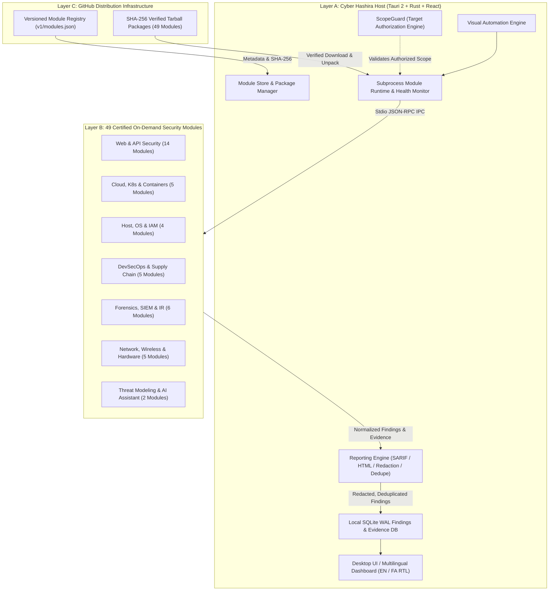

# Cyber Hashira

> **Ultimate Modular Cybersecurity & Penetration Testing Workstation**  
> *GitHub-First • Windows & Ubuntu • Lightweight Host • On-Demand Modules • AI-Powered*

[](LICENSE)
[](.github/workflows/ci.yml)
[](tests/test_all_modules_matrix.py)
[](scripts/reporting_engine.py)
[](#2-supported-platforms)

---

## 1. Overview

**Cyber Hashira** is a unified, extensible cybersecurity workstation designed for authorized penetration testing, security posture auditing, digital forensics, supply-chain verification, and defensive engineering.

Unlike monolithic security suites that package gigabytes of unneeded dependencies into one rigid installer, Cyber Hashira adheres to a **Strict Modular Architecture**:

- **Lightweight Host Application (Layer A):** Built with Tauri 2, React, TypeScript, Rust, and local SQLite WAL. Features workspace management, target authorization boundaries (ScopeGuard), unified findings normalization, evidence tracking, workflow automation, and a built-in Module Store.
- **Independently Installable Modules (Layer B):** 60 specialized cybersecurity disciplines packaged and downloaded strictly on-demand with SHA-256 cryptographic verification.
- **Enterprise Evidence & Reporting Pipeline:** Built-in secret redaction, cross-module finding deduplication, OASIS SARIF v2.1.0 compliance, and printable Executive/Technical HTML/PDF reporting.
- **GitHub Distribution Infrastructure (Layer C):** Versioned JSON registry metadata, SHA-256 integrity verification, and releases distributed securely without persistent server dependencies.

---

## 2. Supported Platforms

| Platform | Support Tier | Architecture | Package Formats |
|---|---|---|---|
| **Windows 10 / 11** | Tier 1 (Official) | x86_64 | MSI Installer, Standalone EXE |
| **Ubuntu 22.04 / 24.04 LTS** | Tier 1 (Official) | x86_64 | DEB Package, AppImage |
| **macOS (Apple Silicon & Intel)** | Tier 2 (Preview) | aarch64 / x86_64 | DMG Package |
| **Linux (ARM64)** | Planned | aarch64 | Tarball |

---

## 3. Core Architecture



---

## 4. Key Highlights

### 🛡️ Non-Negotiable Target Authorization (ScopeGuard)
Active security scans and reconnaissance tools are strictly forbidden from launching against unauthorized targets. Every project defines explicit allowlists (Exact Domains, Wildcards `*.example.com`, Single IPs, or CIDR subnets `192.168.1.0/24`). ScopeGuard intercepts and halts any out-of-scope operation before subprocess execution.

### 📦 Safe, Isolated Module Lifecycle
Modules run in isolated child processes with sandboxed privileges and communicate with the Host exclusively via a standardized stdio JSON-RPC contract (`HealthCheck` / `RunTask` / `TaskCompleted`). No untrusted native dynamic libraries are ever loaded into the privileged Host core process.

### 🔒 Secret & Credential Redaction Engine
Automatic redaction pattern matching ensures that private keys (RSA, EC, PGP), cloud credentials (AWS Access Keys and Secret Keys), Bearer/JWT tokens, Basic auth credentials, and database connection strings are masked across all logs, findings, screenshots, and exported reports.

### 📊 Cross-Module Finding Deduplication
Correlates findings across different security scanners targeting the same asset, generates canonical vulnerability signatures (`target|path|cwe|cve`), merges duplicate entries, consolidates evidence, and tracks all contributing modules.

### 📑 OASIS SARIF v2.1.0 & Executive HTML Reports
Export assessment findings in standardized OASIS SARIF v2.1.0 format (compatible with GitHub Code Scanning, DefectDojo, and Jira) or generate printable executive/technical HTML/PDF reports featuring a 0-100 posture scoring gauge and severity breakdown.

### 🌐 Bilingual Support with Full RTL/LTR Switching
Seamless real-time switching between English (Left-to-Right) and Persian (Right-to-Left) with tailored typography, directional layouts, and localized report generation.

### 🔒 Offline-First & Zero Telemetry
Cyber Hashira operates 100% offline. Findings, targets, captured evidence, and audit logs remain on your local disk in a local SQLite database. No scan results or sensitive client data are ever transmitted to third-party telemetry servers.

---

## 5. Certified Security Disciplines & Available Modules (60 Modules)

The official Cyber Hashira catalog currently distributes **60 independently packaged, certified modules**:

### Web Application & API Security
| Module ID | Name | Version | Capabilities |
|---|---|:---:|---|
| `web-security` | Web Security Workspace | 1.0.0 | Intercepting proxy, HTTP history, Repeater, Decoder/Encoder, passive scan |
| `http-request-smuggling` | HTTP Request Smuggling & Desync Engine | 1.0.0 | CL.TE, TE.CL, TE.TE desync detection, safe timing probes, HTTP/2 downgrade audit |
| `race-condition-engine` | Race Condition & Concurrency Engine | 1.0.0 | Single-packet attack synchronization, limit overrun, double-spend, TOCTOU flaws |
| `oauth-account-takeover` | OAuth 2.0 & SSO Account Takeover Auditor | 1.0.0 | Pre-ATO identification, redirect_uri traversal, state CSRF, open redirect token leak |
| `cache-poisoning-deception` | Web Cache Poisoning & Cache Deception Engine | 1.0.0 | Unkeyed header reflection, Web Cache Deception (WCD) delimiters, Fat GET discrepancies |
| `js-endpoint-miner` | JavaScript Endpoint & Secret Miner | 1.0.0 | Exposed .js.map source maps, hidden REST/GraphQL routes, embedded cloud credentials |
| `param-miner` | Hidden Parameter & Debug Switch Miner | 1.0.0 | Differential query/body analysis, administrative debug switches, HPP discrepancy |
| `ssti-polyglot-engine` | Server-Side Template Injection (SSTI) Engine | 1.0.0 | Multi-dialect arithmetic polyglots (Jinja2, Twig, Freemarker, Spring SpEL, ERB) |
| `prototype-pollution-detector` | Client & Server Prototype Pollution Detector | 1.0.0 | Canary property injection, DOM gadget detection, recursive merge sanitization |
| `nosql-injection-auditor` | NoSQL Injection & MongoDB Operator Auditor | 1.0.0 | MongoDB operators ($ne, $gt, $regex), authentication bypass, blind data extraction |
| `crlf-injection-engine` | CRLF Injection & HTTP Response Splitting Engine | 1.0.0 | %0d%0a CRLF encoding vectors, Set-Cookie session fixation, response splitting |
| `dom-xss-postmessage` | DOM XSS & postMessage Security Auditor | 1.0.0 | DOM source-to-sink data flow tracking, window postMessage origin verification |
| `api-security` | API Security & Schema Assessment | 1.0.0 | REST/GraphQL introspection, Swagger/OpenAPI exposure discovery, BOLA/IDOR checks |
| `auth-multi-role` | Authorization & Multi-Role API Testing | 1.0.0 | BOLA (API1:2023) and BFLA (API5:2023) multi-tenant cross-role testing |
| `authenticated-crawler` | Authenticated Web Crawler & Session Manager | 1.0.0 | Recursive crawl, session cookie preservation, form extraction, hidden admin detection |
| `dast-verifier` | DAST Evidence Verifier & Reproduction | 1.0.0 | Active, non-destructive reproduction probes with strict confidence labeling |
| `api-fuzzing` | Schema-Aware API Fuzzer & Boundary Tester | 1.0.0 | Rate-limited negative testing, type confusion, integer boundaries, 500 error detection |
| `csp-headers-evaluator` | Content Security Policy & Header Auditor | 1.0.0 | CSP Level 3 directives, script-src unsafe-inline, clickjacking frame-ancestors |
| `cors-websocket-audit` | CORS & WebSocket Security Auditor | 1.0.0 | Arbitrary reflected origin, null origin trust, CSWSH WebSocket hijacking audit |
| `cookie-session-hygiene` | Cookie Security & Session Hygiene Inspector | 1.0.0 | HttpOnly, Secure, SameSite, __Host- / __Secure- prefixes, session token entropy |
| `subdomain-takeover-audit` | Subdomain Takeover & Dangling DNS Auditor | 1.0.0 | Dangling CNAMEs pointing to unclaimed AWS S3, GitHub Pages, Heroku, Azure |
| `ssrf-guard-validator` | SSRF & Cloud Metadata Defense Validator | 1.0.0 | Cloud metadata 169.254.169.254, RFC 1918 private subnets, IP obfuscation |
| `graphql-security-audit` | GraphQL Schema & Query Depth Auditor | 1.0.0 | Introspection queries, circular query depth DoS, batching amplification leaks |
| `jwt-security-analyzer` | JWT & Cryptographic Token Analyzer | 1.0.0 | 'alg: none' bypass, weak HMAC secrets, RSA-to-HMAC confusion, exp expiration |
| `waf-evasion-defense` | WAF & Normalization Defense Validator | 1.0.0 | Full-width Unicode normalization discrepancies, HPP precedence mismatches |

### Cloud, Infrastructure & Containers
| Module ID | Name | Version | Capabilities |
|---|---|:---:|---|
| `cloud-iac-security` | Infrastructure as Code & Cloud Security | 1.0.0 | CIS AWS & K8s benchmarks, public S3 buckets, open 0.0.0.0/0 SSH/RDP |
| `cloud-iam` | Cloud IAM & Excessive Privilege Auditor | 1.0.0 | Wildcard admin (*:*), public bucket permissions, cross-account trust policies |
| `kubernetes-posture` | Kubernetes Security Posture & RBAC Auditor | 1.0.0 | Pod Security Standards (PSS), privileged pods, wildcard RBAC, hostPath mounts |
| `container-security` | Container & Dockerfile Security Inspector | 1.0.0 | CIS Docker Benchmark, root user execution, sensitive socket mounts |
| `docker-runtime` | Docker Daemon & Runtime Hardening Inspector | 1.0.0 | Plaintext TCP socket exposure, userns-remap, inter-container communication (icc) |
| `iac-remediation-advisor` | IaC Automated Remediation Advisor | 1.0.0 | Generates unified Git diff patches for Terraform and Kubernetes security violations |

### Host, Endpoint & Database Security
| Module ID | Name | Version | Capabilities |
|---|---|:---:|---|
| `host-posture` | Host & Endpoint Security Posture Inspector | 1.0.0 | Windows Defender, BitLocker, Firewall profiles; Linux SSH hardening & sysctl |
| `database-audit` | Database Security & Configuration Auditor | 1.0.0 | PostgreSQL, MySQL, MongoDB mandatory TLS, superuser privileges, wildcard binding |
| `identity-ad-hygiene` | Active Directory & Identity Hygiene Auditor | 1.0.0 | AS-REP Roasting pre-auth risks, Kerberoasting SPN audit, stale admin accounts |
| `credentials-vault` | Secrets & Credential Vault Engine | 1.0.0 | AES-256-GCM vault, credential age tracking, automated rotation advisories |

### Source Code, CI/CD & Supply Chain
| Module ID | Name | Version | Capabilities |
|---|---|:---:|---|
| `sast-source-scanner` | Static Application Security Testing (SAST) | 1.0.0 | Source-to-sink detection for SQLi, command injection, insecure deserialization |
| `secrets-leak-scanner` | Secrets, API Keys & PII Leak Scanner | 1.0.0 | Multi-cloud credential leak detection (AWS, GitHub, Stripe, OpenAI, SSH keys) |
| `sbom-dependency-audit` | SBOM & Dependency Vulnerability Auditor | 1.0.0 | CycloneDX v1.4 SBOM generation, package.json / requirements.txt CVE matching |
| `sca-license-compliance` | SCA Open Source License Compliance Auditor | 1.0.0 | Detection of viral copyleft licenses (GPL, AGPL) and commercial license conflicts |
| `cicd-supply-chain` | CI/CD Supply Chain & Attestation Validator | 1.0.0 | Cosign artifact signatures, SLSA v1.0 provenance levels, ephemeral runner audit |
| `github-actions-security` | GitHub Actions & CI/CD Security Inspector | 1.0.0 | OWASP CI/CD Top 10, script injection in `run:`, unpinned actions |

### Forensics, SIEM & Incident Response
| Module ID | Name | Version | Capabilities |
|---|---|:---:|---|
| `forensics` | Digital Forensics & Malware Triage | 1.0.0 | MD5/SHA-1/SHA-256 hashes, Shannon entropy (>7.0 packed binary detection) |
| `network-forensics-pcap` | Network Forensics & PCAP Credentials | 1.0.0 | Deep packet inspection, cleartext password harvesting, NetNTLMv2 hash recovery |
| `incident-response` | Incident Response & Evidence Chain-of-Custody | 1.0.0 | ISO/IEC 27037 custody preservation, timeline correlation, evidence hashing |
| `siem-connectors` | Enterprise SIEM & SOC Telemetry Ingestion | 1.0.0 | Read-only alert ingestion from Elastic, Splunk, and Wazuh; sensor health checks |
| `sigma-threat-hunting` | Sigma Threat Hunting Rule Engine | 1.0.0 | Sigma YAML detection evaluation, Splunk SPL & Elasticsearch KQL translation |
| `yara-offline-scanner` | YARA Offline Malware Signature Scanner | 1.0.0 | Safe offline pattern scanning for webshells, beacons, and ransomware strings |

### Reconnaissance, Threat Intel & Architecture
| Module ID | Name | Version | Capabilities |
|---|---|:---:|---|
| `sample-dns` | DNS Reconnaissance Engine | 1.0.0 | A, AAAA, MX, NS, TXT record lookups & DNS misconfiguration detection |
| `network-security` | Network Discovery & Port Scanner | 1.0.0 | Nmap adapter + async socket fallback, banner grabbing, service identification |
| `threat-intelligence` | Threat Intelligence & MITRE Engine | 1.0.0 | IOC enrichment (IP, domain, hashes), LockBit/Cobalt Strike triage, MITRE ATT&CK |
| `sensor-coverage-attack` | MITRE Sensor Mappings & Detection Coverage | 1.0.0 | Telemetry coverage against Sysmon, Auditd, Zeek, Suricata; blindspot analysis |
| `email-security` | Email Security & Anti-Spoofing Auditor | 1.0.0 | SPF (+all/~all/-all), DMARC (p=reject vs none), DKIM alignment, BIMI, MTA-STS |
| `vulnerability` | Vulnerability Assessment & Correlation Engine | 1.0.0 | Nuclei template parser, CVE/CWE mapping, CVSS v3.1 scoring, SARIF v2.1.0 export |
| `threat-modeling` | Automated Threat Modeling Engine (STRIDE) | 1.0.0 | DFD diagram analysis, trust boundaries, STRIDE/DREAD threat classification |
| `hashira-ai` | Hashira AI Defensive Assistant | 1.0.0 | Secret redaction, CVSS triage, bilingual Persian/English reasoning |

### Mobile, Hardware & Automotive Security
| Module ID | Name | Version | Capabilities |
|---|---|:---:|---|
| `mobile-static-audit` | Mobile Application Static Security Auditor | 1.0.0 | APK/IPA permissions, usesCleartextTraffic, allowBackup, embedded secrets |
| `wireless-security` | Wireless & 802.11 WiFi Security Inspector | 1.0.0 | WEP deprecation, WPA-TKIP auditing, WPS Pixie-Dust risk analysis |
| `canbus-automotive-security` | CAN Bus & Automotive Vehicle Security | 1.0.0 | Passive CAN log inspection, arbitration DoS flooding (ID 0x000), UDS 0x27 bypass |
| `automotive-uds-analyzer` | Automotive UDS Diagnostics Security Analyzer | 1.0.0 | Passive UDS (ISO 14229) analysis, static seed generation, ECU reflash checks |

---

## 6. Enterprise Evidence & Reporting Engine

Cyber Hashira includes a dedicated reporting and evidence engine (`scripts/reporting_engine.py`) designed for both interactive desktop and headless CLI CI/CD workflows:

### CLI Commands:
```bash
# 1. Run a module and export directly to OASIS SARIF v2.1.0
python scripts/cyber_hashira_cli.py run --module api-security --target https://api.target.com --format sarif --output scan.sarif

# 2. Run a module and generate a printable executive HTML report
python scripts/cyber_hashira_cli.py run --module kubernetes-posture --target k8s-cluster --format html --output k8s-report.html

# 3. Convert an existing findings JSON into an executive HTML report
python scripts/cyber_hashira_cli.py report --input findings.json --format html --output executive-report.html

# 4. Convert findings into SARIF for GitHub Code Scanning
python scripts/cyber_hashira_cli.py report --input findings.json --format sarif --output results.sarif
```

---

## 7. Quickstart & Verification

### Prerequisites
- **Node.js:** v20+ with `pnpm`
- **Python:** 3.10+
- **Rust:** 1.78+ (`rustc`, `cargo` for native Host compilation)

### Automated Test Matrix (49 Modules Certified)
```bash
# 1. Clone the repository
git clone https://github.com/VoidStudioos/Cyber-Hashira.git
cd Cyber-Hashira

# 2. Synchronize and package all 49 modules into registry
python scripts/package_all_modules.py

# 3. Run the master 5-gate verification test harness across all 49 modules
python tests/test_all_modules_matrix.py

# 4. Verify the secret redaction and reporting pipeline
python tests/test_reporting_engine.py

# 5. Build Desktop Frontend Application
pnpm install
pnpm build
```

---

## 8. Project Structure

```text
Cyber-Hashira/
├── apps/
│   ├── desktop/          # Tauri 2 Desktop Shell + React 18 + Vite + Tailwind CSS
│   └── server/           # Optional multi-user team synchronization server
├── crates/
│   ├── core/             # SQLite DB WAL, project & target manager, findings manager
│   ├── scope-guard/      # Mandatory target authorization & parsed URL boundary validation
│   ├── module-runtime/   # Secure module installer, unpacker & JSON-RPC executor
│   ├── plugin-sdk/       # Standard Plugin Manifest & IPC contract definitions
│   └── proxy/            # Intercepting HTTP/S proxy core
├── modules/              # 49 Independently maintainable security modules
├── registry/
│   ├── v1/modules.json   # Machine-readable registry catalog (49 certified entries)
│   └── artifacts/        # SHA-256 verified module tarball archives (*.tar.gz)
├── scripts/
│   ├── cyber_hashira_cli.py     # Headless CLI runner and report generator
│   ├── reporting_engine.py      # Secret redaction, deduplication, SARIF & HTML reports
│   └── package_all_modules.py   # Module packager and SHA-256 registry synchronizer
├── tests/
│   ├── test_all_modules_matrix.py  # Master 5-gate test harness for all 49 modules
│   └── test_reporting_engine.py    # Test suite for secret redaction, dedupe, SARIF & HTML
└── .github/workflows/    # Multi-platform CI/CD pipelines (Host CI, Windows, Ubuntu)
```

---

## 9. License & Ethics

Distributed under the **Apache License 2.0**. See [`LICENSE`](LICENSE) for details.

> **Ethical Use Notice:** Cyber Hashira is engineered exclusively for authorized security research, educational purposes, and certified penetration testing with explicit written consent. Unauthorized scanning of third-party networks or systems is strictly illegal and prohibited.
